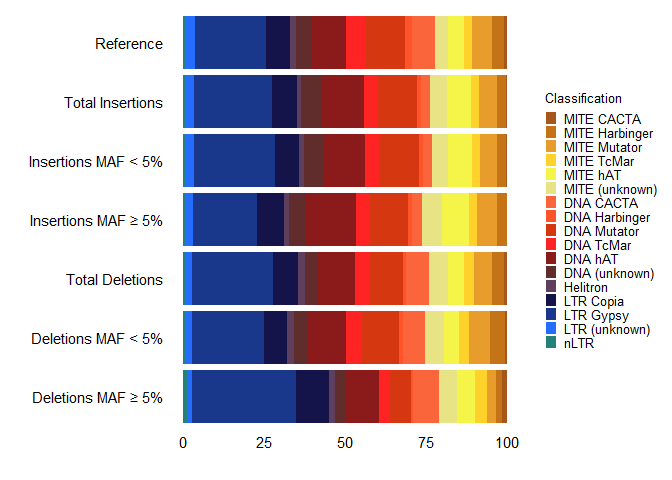
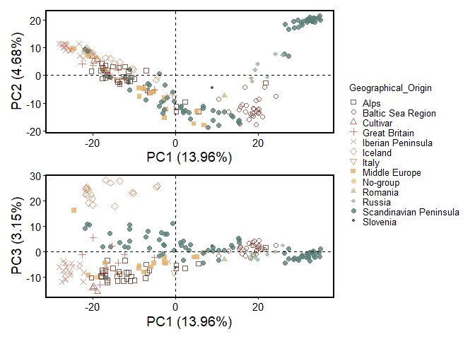
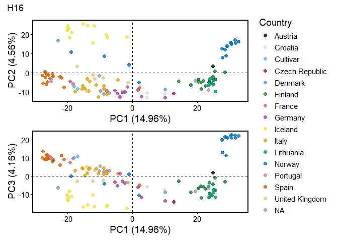
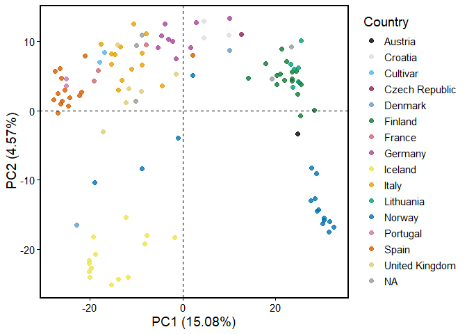
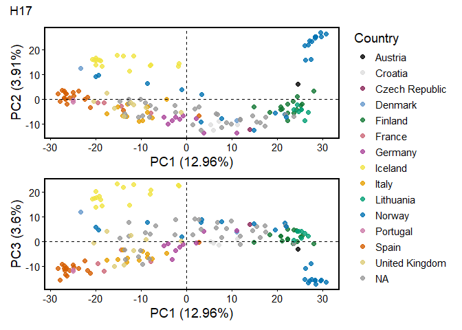
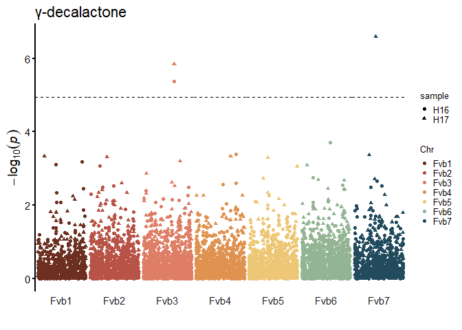
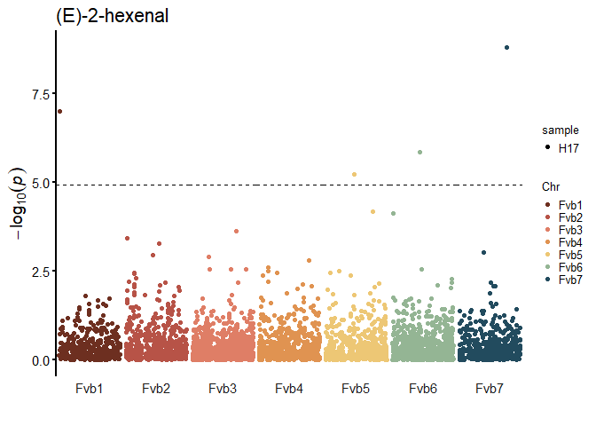
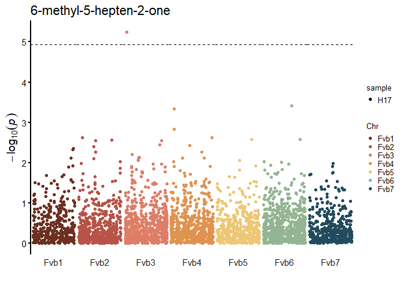
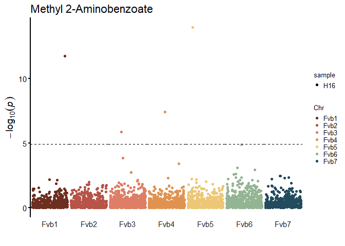

Priego-Cubero, Tolley, et al. (2026): TE-Polymorphisms-and-GWAS
================
2026-02-03

Scripts for the data analysis of Priego-Cubero, Tolley et al. 2026 doi: https://doi.org/10.1101/2025.03.20.644342

All related input and output files can be download from the repository: 

# Install and load required packages and scripts

``` r
# R
renv::init()
renv::install('tidyverse')
renv::install('patchwork')
renv::install('MetBrewer')
renv::install('readxl')

#### INSTALLING GAPIT 
renv::install('remotes')
remotes::install_github("jiabowang/GAPIT@GAPIT3.5")
```

``` r
# R
library(tidyverse)
```

    ## ── Attaching core tidyverse packages ──────────────────────── tidyverse 2.0.0 ──
    ## ✔ dplyr     1.1.4     ✔ readr     2.1.6
    ## ✔ forcats   1.0.1     ✔ stringr   1.6.0
    ## ✔ ggplot2   4.0.1     ✔ tibble    3.3.1
    ## ✔ lubridate 1.9.4     ✔ tidyr     1.3.2
    ## ✔ purrr     1.2.1     
    ## ── Conflicts ────────────────────────────────────────── tidyverse_conflicts() ──
    ## ✖ dplyr::filter() masks stats::filter()
    ## ✖ dplyr::lag()    masks stats::lag()
    ## ℹ Use the conflicted package (<http://conflicted.r-lib.org/>) to force all conflicts to become errors

``` r
library(patchwork)
library(readxl)
source("scripts/build_polymorphism_table.R")
```

# Formatting TE annotation for TEPID

## Intact TEs

- Read intact transposable element (TE) annotation.

- Because the file is in `GFF` format, which uses `1-based` coordinates,
  I converted it to `0-based` coordinates (as used in `BED` format) to
  ensure accurate mapping between the TE annotation and the BED deletion
  file.

- This way, it can match the TE annotation with the bed deletion file
  (downstream).

``` r
# R
intact_tes <-
  read_tsv(file = 'input/TEanno.intact.gff',
           col_names = c('chr', 'annotator', 'te_name', 
                         'start', 'end', 'score', 'strand', 
                         'score_2', 'metadata')
           ) %>%
  select(chr, start, end, te_name) %>%
  mutate(start = start - 1) %>%
  unite(col = 'te_id', sep = '_', chr:te_name, remove = FALSE)
```

    ## Rows: 5014 Columns: 9
    ## ── Column specification ────────────────────────────────────────────────────────
    ## Delimiter: "\t"
    ## chr (7): chr, annotator, te_name, score, strand, score_2, metadata
    ## dbl (2): start, end
    ## 
    ## ℹ Use `spec()` to retrieve the full column specification for this data.
    ## ℹ Specify the column types or set `show_col_types = FALSE` to quiet this message.

## Intact TEs and its fragmented copies

The TE annotation will be formatted for compatibility with `TEPID`,
utilizing the following column structure:

    chromosome start stop strand TE_name TE_family TE_superfamily

Following Rocio’s logic from:
<https://github.com/Ro-Toll/TE-Annotation-and-Polymorphisms_Auxiliary-Scripts/blob/main/TE_annotation/TEanno_TEPID.bed>

Input file (combined TE annotation including all intact and fragmented
TEs, and inverted repeats not derived from MITEs):

    Combined_TEanno_full_and_IRs_less20_no_MITE.bed

``` r
# R
full_tes <- 
  read_tsv(file = 'input/Combined_TEanno_full_and_IRs_less20_no_MITE.bed',
           col_names = c('chr', 'start', 'end', 'strand', 'te_name')
           )
```

    ## Rows: 123485 Columns: 5
    ## ── Column specification ────────────────────────────────────────────────────────
    ## Delimiter: "\t"
    ## chr (3): chr, strand, te_name
    ## dbl (2): start, end
    ## 
    ## ℹ Use `spec()` to retrieve the full column specification for this data.
    ## ℹ Specify the column types or set `show_col_types = FALSE` to quiet this message.

``` r
te_ann_for_tepid <- 
  
  full_tes %>%
  
  # Add superfamily and family columns 
  
  separate(te_name, into = c('name', 'te_family'), sep = '#', remove = FALSE) %>%
  mutate(te_family = case_when(
                              str_detect(te_name, "IR:") ~ paste0("IR"),
                              .default = te_family
                              ) ) %>%
  separate(te_family, into = c('name1', 'name2', 'name3'), sep = '/', remove = FALSE) %>%
  unite(name1:name2, col = 'te_superfamily', sep = '/') %>%
  select(c('chr', 'start', 'end', 'strand', 'te_name', 'te_family', 'te_superfamily')) %>%
  mutate(te_superfamily = str_replace(te_superfamily, "/NA", "")) %>%
  
  # Generate unique id for TE copies based on the union of the TE coordinates and TE name 
  
  unite(c('chr', 'start', 'end', 'te_name'), col = 'te_name', sep = '-', remove = FALSE) %>%
  select(c('chr', 'start', 'end', 'strand', 'te_name', 'te_family', 'te_superfamily'))

write_tsv(te_ann_for_tepid, file = 'output/Combined_TEanno_Full_and_IRs_less20_no_MITE.FOR_TEPID.bed', col_names = FALSE)
```

# TEPID: Discovery of TE Polymorphisms in resequenced F. vesca genomes

The following `Bash` commands were used to call transposable element
polymorphisms (TEPs) across the population using `TEPID`

First, download the F. vesca reference files from the Rosaceae database.
Note that while the latest annotation version is `v4.0.a2`, the
corresponding genome assembly remains `v4.0.a1`.

``` bash
# bash
mkdir working_directory
cd working_directory
wget https://www.rosaceae.org/rosaceae_downloads/Fragaria_vesca/Fvesca-genome.v4.0.a1/assembly/Fragaria_vesca_v4.0.a1.fasta.gz
```

## a) Pull required containers

``` bash
# bash
module load singularity/3.7.2

singularity pull yaha.sif docker://quay.io/biocontainers/yaha:0.1.83--h503566f_7
singularity pull tepid.sif docker://quay.io/biocontainers/tepid:0.10--py_0
```

## b) Prepare input data

### Bowtie2 index

``` bash
# bash
module load bowtie/2.5.1
mkdir bowtie2_index
bowtie2-build --threads 12 working_directory/Fragaria_vesca_v4.0.a1.fasta working_directory/bowtie2_index/Fragaria_vesca_v4.0.a1
```

### Yaha index

Using a container with the version `0.1.83`

``` bash
# bash
# Pull container
module load singularity/3.7.2

mkdir yaha_index
cd yaha_index

singularity \
    exec \
        --bind /working_directory:/mnt \
        /mnt/yaha.sif \
        yaha \
        -g /mnt/Fragaria_vesca_v4.0.a1.fasta
```

### Prepare `fastq` files

In our case, the sequencing data was obtained as `BAM` files from:

Toivainen, T., Salonen, J.S., Kirshner, J. *et al.* The Late Quaternary
climate impact on the genome of the woodland strawberry (*Fragaria
vesca*), a perennial herb. *Commun Biol* (2026).
<https://doi.org/10.1038/s42003-026-09539-5>

`TEPID` uses a two-step mapping strategy. Consequently, reads must be
re-extracted into `fastq` format and subsequently re-mapped according to
the TEPID pipeline requirements.

``` bash
# bash
mkdir bam_files
mkdir fastq_files

for bam in $(ls /working_directory/bam_files/*.bam); do

    sample_name=$(basename "$bam" .sort.dedup.bam)
    output_dir="/working_directory/fastq_files/"

    samtools collate -u -O $bam |
    samtools fastq \
        -1 $output_dir/${sample_name}_1.fq \
        -2 $output_dir/${sample_name}_2.fq \
        -0 /dev/null \
        -s /dev/null \
        -n
done
```

## c) Step 1: Mapping

`<sample_name>` will represent the name of your sample file. This
command was run for all the samples

``` bash
# bash
module load singularity/3.7.2

mkdir /working_directory/mapping/<sample_name>

singularity \
    exec \
        --home /working_directory/mapping/<sample_name> \
        --bind /working_directory:/mnt \
        /working_directory/tepid.sif \
        tepid-map \
            -x /mnt/bowtie2_index/Fragaria_vesca_v4.0.a1 \
            -y /mnt/yaha_index/Fvesca.X15_01_65525S \
            -p $SLURM_CPUS_PER_TASK \
            -s 250 \
            -n <sample_name> \
            -1 /mnt/fastq_files/<sample_name>.fq \
            -2 /mnt/fastq_files/<sample_name>.fq > <sample_name>.tepid-map.log 2> <sample_name>.tepid-map.err
```

## d) Step 2: Polymorphism Discovery

Variant calling using the comprehensive TE annotation

``` bash
# bash
module load singularity/3.7.2

mkdir /working_directory/discovery

input_directory="/working_directory/mapping"
directory="/working_directory/discovery"
cd $directory

for f in $(ls $input_directory); do

    sample_name=$(basename $f)
    mkdir -p results_discovery/$sample_name

    cp $input_directory/$sample_name/* $directory/results_discovery/$sample_name

    singularity \
    exec \
        --home $directory/results_discovery/$sample_name \
        --bind /working_directory:/mnt \
        --pwd /mnt/discovery/results_discovery/$sample_name \
        /working_directory/tepid.sif \
        tepid-discover \
            -p 1 \
            -n $sample_name \
            -c $sample_name.bam \
            -s $sample_name.split.bam \
            --te /mnt/Combined_TEanno_Full_and_IRs_less20_no_MITE.FOR_TEPID.bed

rm $directory/results_discovery/$sample_name/*.temp
rm $directory/results_discovery/$sample_name/*.bam
rm $directory/results_discovery/$sample_name/*.bam.bai
rm $directory/results_discovery/$sample_name/*.tepid-map.*

done
```

## e) Intermediate Step: Merging deletions and insertions

Following the initial discovery phase, the individual insertion and
deletion files for each accession are merged to create a single,
comprehensive population-level file containing all detected
polymorphisms.

Scripts from
<https://github.com/ListerLab/TEPID/blob/master/Scripts/merge_deletions.py>
<https://github.com/ListerLab/TEPID/blob/master/Scripts/merge_insertions.py>

``` bash
# bash
module load singularity/3.7.2

singularity \
    exec \
        --home /working_directory/discovery/results_discovery \
        --bind /working_directory:/mnt \
        --pwd /mnt/discovery/results_discovery \
        /working_directory/tepid.sif \
        /mnt/merge_deletions.py -f deletions

singularity \
    exec \
        --home /working_directory/discovery/results_discovery \
        --bind /working_directory:/mnt \
        --pwd /mnt/discovery/results_discovery \
        /working_directory/tepid.sif \
        /mnt/merge_insertions.py -f insertions
```

## f) Step 3: Refinement

The refinement requires the merged files generated in the previous step.

`insertions_poly_te.bed`: The file containing merged insertions
identified during discovery.

`deletions.bed`: The file containing merged deletions identified during
discovery.

``` bash
# bash
module load singularity/3.7.2

input_directory="/working_directory/mapping"
directory="/working_directory/refine"
cd $directory

for f in $(ls $input_directory); do

    sample_name=$(basename $f)
    mkdir -p results_refine/$sample_name

    cp $input_directory/$sample_name/* $directory/results_refine/$sample_name
    
    # TEPID REFINE REQUIRES THE FILES DELETIONS,INSERTIONS_READS_SAMPLE.TXT IN THE WORKING DIRECTORY 
    cp /working_directory/refine/results_refine/$sample_name/* $directory/results_refine/$sample_name

    singularity \
    exec \
        --home $directory/results_refine/$sample_name \
        --bind /working_directory:/mnt \
        --pwd /mnt/refine/results_refine/$sample_name \
        /working_directory/tepid.sif \
        tepid-refine \
            -p 1 \
            -n $sample_name \
            -i /mnt/discovery/results_discovery/insertions_poly_te.bed \
            -d /mnt/discovery/results_discovery/deletions.bed \
            -a /mnt/samples_all.txt \
            -c $sample_name.bam \
            -s $sample_name.split.bam \
            --te /mnt/Combined_TEanno_Full_and_IRs_less20_no_MITE.FOR_TEPID.bed
    
    rm $directory/results_refine/$sample_name/*.bam
    rm $directory/results_refine/$sample_name/*.temp
    rm $directory/results_refine/$sample_name/*.bai
done
```

## g) Intermediate Step: Merging final deletions and insertions

This step involves combining the outputs from the discovery and
refinement steps to produce a final set of variants for each accession.

- For deletions, the process is straightforward. The discovery-phase
  deletions are combined with the “second-pass” deletions using a simple
  `cat`

- Merging insertions requires more care due to inconsistent file
  structures across `TEPID` outputs:

  - Discovery Insertions: 8 columns.

  - Second-pass Insertion files: 5 columns. Three extra columns added
    with the coordinates of the origin of the inserted TE (same format
    as discovery insertions).

``` bash
# bash
refine_directory="/working_directory/refine/results_refine"
discover_directory="/working_directory/discovery/results_discovery"

cd /working_directory

for f in $(ls $discover_directory); do

    sample_name=$(basename $f)
    mkdir -p final_set/$sample_name

    cat $discover_directory/$sample_name/deletions_${sample_name}.bed  $refine_directory/$sample_name/second_pass_deletion_${sample_name}.bed > final_set/$sample_name/final_deletions_${sample_name}.bed

    awk -v FS='\t' -v OFS='\t' '{n = split($4, a, "-"); print $1, $2, $3, a[1], a[2], a[3], $4, $5;}' $refine_directory/$sample_name/second_pass_insertion_${sample_name}.bed > $refine_directory/$sample_name/second_pass_insertion_${sample_name}_temp.bed

    cat $discover_directory/$sample_name/insertions_${sample_name}.bed $refine_directory/$sample_name/second_pass_insertion_${sample_name}_temp.bed > final_set/$sample_name/final_insertions_${sample_name}.bed
    
done
```

Merging final deletions and insertions

``` bash
# bash
module load singularity/3.7.2

singularity \
    exec \
        --home /working_directory/final_set \
        --bind /working_directory:/mnt \
        --pwd /mnt/final_set \
        /working_directory/tepid.sif \
        /mnt/merge_deletions.py -f final_deletions

singularity \
    exec \
        --home /working_directory/final_set \
        --bind /working_directory:/mnt \
        --pwd /mnt/final_set \
        /working_directory/tepid.sif \
       /mnt/merge_insertions.py -f final_insertions
```

# Distribution of polymorphisms

## Read tables

### Read list of 210 accesions

Accessions utilized for `TEPID` polymorphism calling.

``` r
# R
accessions_all <- read_table(file = 'input/samples_all.txt', 
                             col_names = 'accession') %>% 
                  as_vector()
```

    ## 
    ## ── Column specification ────────────────────────────────────────────────────────
    ## cols(
    ##   accession = col_character()
    ## )

### Read final insertion/deletion files

The function `build_polymorphism_table` processes the final insertions
and deletions merged after the TEPID refinement step (described above).
It constructs a comprehensive polymorphism table where each row
represents a detected variant. The function also calculates the **Minor
Allele Frequency (MAF)** for each site. The logic is documented inside
the function located in the `scripts` folder; a summary of the workflow
is provided below:

- **Read Input Files:** The function reads the refined insertion and
  deletion files.
  - **Deletions:** Processed via a standard `read_tsv`.
  - **Insertions:** To address cases where a single insertion contains
    multiple TE entries (separated by commas), the function simplifies
    the data. Since the refinement step may generate separate rows with
    slightly different coordinates for the insertion, the function
    **collapses** the accessions carrying the polymorphism and assigns
    the event to the first TE listed.

Example of duplicated insertion:

    Fvb1-12549573-12549656-Fvb3-13451722-13452098-IR:Fvb3:13451722:13452098,Fvb3-13451709-13452112-TE_00000044#DNA/nMITE/Mutator

- **Identify Absent Accessions:** A column is added listing
  comma-separated accessions that **do not** carry the polymorphism
  (i.e., they match the reference genome).
- **Calculate MAF:** The function counts carrier (“present”) and
  non-carrier (“absent”) accessions. The **MAF (%)** is calculated by
  identifying the less frequent allele (whether it is the presence or
  absence of the TE).

The resulting tables have the following columns:

|  |  |
|----|----|
| Column | Description |
| **TE_id** | Unique identifier combining coordinates (`chr-start-end`). For insertions, this includes both the locus and the inserted TE coordinates. |
| **TE_name** | The TE name, including family and superfamily information (separated by `#`). |
| **TE_numb** | The specific TE name without family information. |
| **TE_class** | Family and superfamily information (separated by `/`). |
| **present** | Comma-separated list of accessions carrying the polymorphism. |
| **absent** | Comma-separated list of accessions lacking the polymorphism (reference-like). |
| **present_count** | Total number of carrier accessions. |
| **absent_count** | Total number of non-carrier accessions. |
| **total** | Total number of accessions analyzed (used for Quality Control). |
| **MAF** | Minor Allele Frequency expressed as a percentage (%). |

``` r
# R
deletions <- build_polymorphism_table(polymorphism_file = 'input/polymorphisms/final_deletions_full.bed',
                                      insertions = FALSE,
                                      accessions_all = accessions_all,
                                      total_accessions = 210) %>%
             mutate(TE_class = case_when(
                                      str_detect(TE_name, "IR:") ~ "IR",
                                      .default = TE_class
                                      )
                     )
```

    ## Rows: 11345 Columns: 6
    ## ── Column specification ────────────────────────────────────────────────────────
    ## Delimiter: "\t"
    ## chr (4): chr, strand, TE_id, present
    ## dbl (2): start, end
    ## 
    ## ℹ Use `spec()` to retrieve the full column specification for this data.
    ## ℹ Specify the column types or set `show_col_types = FALSE` to quiet this message.

``` r
insertions <- build_polymorphism_table(polymorphism_file = 'input/polymorphisms/final_insertions_full.bed',
                                      insertions = TRUE,
                                      accessions_all = accessions_all,
                                      total_accessions = 210) %>%
              mutate(TE_class = case_when(
                                      str_detect(TE_name, "IR:") ~ "IR",
                                      .default = TE_class
                                      )
                     )
```

    ## Rows: 8266 Columns: 8
    ## ── Column specification ────────────────────────────────────────────────────────
    ## Delimiter: "\t"
    ## chr (4): chr, chr_te, TE_id, present
    ## dbl (4): start, end, start_te, end_te
    ## 
    ## ℹ Use `spec()` to retrieve the full column specification for this data.
    ## ℹ Specify the column types or set `show_col_types = FALSE` to quiet this message.

# TABLE 2: Number of polymorphisms detected

Code used to get the results presented in table 2. Evaluate the number
of polymorphisms detected by TEPID for each element annotated (TE, MITE,
IR).

Just to have a reference of all the type of TEs that are considered on
each polymorphisms table:

``` r
# R
deletions %>%
  select(TE_class) %>%
  as_vector() %>%
  table()
```

    ## .
    ##        DNA/Helitron            DNA/MITE      DNA/MITE/CACTA  DNA/MITE/Harbinger 
    ##                 220                 609                 102                 393 
    ##        DNA/MITE/hAT    DNA/MITE/Mutator      DNA/MITE/TcMar           DNA/nMITE 
    ##                 508                 572                 323                 400 
    ##     DNA/nMITE/CACTA DNA/nMITE/Harbinger       DNA/nMITE/hAT   DNA/nMITE/Mutator 
    ##                 729                  98                1133                1051 
    ##     DNA/nMITE/TcMar     DNA/unknown/hAT DNA/unknown/Mutator                  IR 
    ##                 472                  50                   7                 983 
    ##                 LTR           LTR/Copia           LTR/Gypsy        nLTR/LINE/L1 
    ##                 213                 814                2586                  17 
    ##            nLTR/PLE 
    ##                  65

All type of inserted TEs

``` r
# R
insertions %>%
  select(TE_class) %>%
  as_vector() %>%
  table()
```

    ## .
    ##          DNA/Helitron              DNA/MITE        DNA/MITE/CACTA 
    ##                   111                   418                    17 
    ##    DNA/MITE/Harbinger          DNA/MITE/hAT      DNA/MITE/Mutator 
    ##                   229                   573                   422 
    ##        DNA/MITE/TcMar             DNA/nMITE       DNA/nMITE/CACTA 
    ##                   200                   465                   208 
    ##   DNA/nMITE/Harbinger         DNA/nMITE/hAT     DNA/nMITE/Mutator 
    ##                    97                  1000                   928 
    ##       DNA/nMITE/TcMar DNA/unknown/Harbinger       DNA/unknown/hAT 
    ##                   336                     5                    45 
    ##   DNA/unknown/Mutator                    IR                   LTR 
    ##                    23                   351                   200 
    ##             LTR/Copia             LTR/Gypsy          nLTR/LINE/L1 
    ##                   598                  1893                    13 
    ##              nLTR/PLE 
    ##                    52

#### IRs

Sanity check to confirm that the regex works properly (just comparing
the numbers below to the numbers above)

``` r
# R
deletions %>%
  filter(str_detect(TE_name, "IR:") ) %>%
  select(TE_class) %>%
  as_vector() %>%
  table()
```

    ## .
    ##  IR 
    ## 983

``` r
# R
insertions %>%
  filter(str_detect(TE_name, "IR:") ) %>%
  select(TE_class) %>%
  as_vector() %>%
  table()
```

    ## .
    ##  IR 
    ## 351

``` r
# R
deletions %>%
  filter(str_detect(TE_name, "IR:")) %>%
  summarise(total_ir_deletions = n()) %>%
  as_vector()
```

    ## total_ir_deletions 
    ##                983

``` r
deletions %>%
  filter(str_detect(TE_name, "IR:"), MAF >= 5) %>%
  summarise(ir_deletions_above_MAF5 = n()) %>%
  as_vector()
```

    ## ir_deletions_above_MAF5 
    ##                     197

``` r
deletions %>%
  filter(str_detect(TE_name, "IR:"), MAF < 5) %>%
  summarise(ir_deletions_below_MAF5 = n()) %>%
  as_vector()
```

    ## ir_deletions_below_MAF5 
    ##                     786

``` r
insertions %>%
  filter(str_detect(TE_name, "IR:")) %>%
  summarise(total_ir_insertions = n())%>%
  as_vector()
```

    ## total_ir_insertions 
    ##                 351

``` r
insertions %>%
  filter(str_detect(TE_name, "IR:"), MAF >= 5) %>%
  summarise(ir_insertions_above_MAF5 = n()) %>%
  as_vector()
```

    ## ir_insertions_above_MAF5 
    ##                       42

``` r
insertions %>%
  filter(str_detect(TE_name, "IR:"), MAF < 5) %>%
  summarise(ir_insertions_below_MAF5 = n()) %>%
  as_vector()
```

    ## ir_insertions_below_MAF5 
    ##                      309

#### MITEs

Sanity check that the regex works properly

``` r
# R
deletions %>%
  filter(str_detect(TE_name, "/MITE") ) %>%
  select(TE_class) %>%
  as_vector() %>%
  table()
```

    ## .
    ##           DNA/MITE     DNA/MITE/CACTA DNA/MITE/Harbinger       DNA/MITE/hAT 
    ##                609                102                393                508 
    ##   DNA/MITE/Mutator     DNA/MITE/TcMar 
    ##                572                323

``` r
# R
insertions %>%
  filter(str_detect(TE_name, "/MITE") ) %>%
  select(TE_class) %>%
  as_vector() %>%
  table()
```

    ## .
    ##           DNA/MITE     DNA/MITE/CACTA DNA/MITE/Harbinger       DNA/MITE/hAT 
    ##                418                 17                229                573 
    ##   DNA/MITE/Mutator     DNA/MITE/TcMar 
    ##                422                200

``` r
# R
deletions %>%
  filter(str_detect(TE_name, "/MITE")) %>%
  summarise(total_MITE_deletions = n()) %>%
  as_vector()
```

    ## total_MITE_deletions 
    ##                 2507

``` r
deletions %>%
  filter(str_detect(TE_name, "/MITE"), MAF >= 5) %>%
  summarise(MITE_deletions_above_MAF5 = n()) %>%
  as_vector()
```

    ## MITE_deletions_above_MAF5 
    ##                       601

``` r
deletions %>%
  filter(str_detect(TE_name, "/MITE"), MAF < 5) %>%
  summarise(MITE_deletions_below_MAF5 = n()) %>%
  as_vector()
```

    ## MITE_deletions_below_MAF5 
    ##                      1906

``` r
insertions %>%
  filter(str_detect(TE_name, "/MITE")) %>%
  summarise(total_MITE_insertions = n()) %>%
  as_vector()
```

    ## total_MITE_insertions 
    ##                  1859

``` r
insertions %>%
  filter(str_detect(TE_name, "/MITE"), MAF >= 5) %>%
  summarise(MITE_insertions_above_MAF5 = n()) %>%
  as_vector()
```

    ## MITE_insertions_above_MAF5 
    ##                        336

``` r
insertions %>%
  filter(str_detect(TE_name, "/MITE"), MAF < 5) %>%
  summarise(MITE_insertions_below_MAF5 = n()) %>%
  as_vector()
```

    ## MITE_insertions_below_MAF5 
    ##                       1523

## Rest of TEs

Sanity check that the regex works properly

``` r
# R
deletions %>%
  #filter(!str_detect(TE_name, "/MITE") & !str_detect(TE_name, "IR:") ) %>%
  select(TE_class) %>%
  as_vector() %>%
  table()
```

    ## .
    ##        DNA/Helitron            DNA/MITE      DNA/MITE/CACTA  DNA/MITE/Harbinger 
    ##                 220                 609                 102                 393 
    ##        DNA/MITE/hAT    DNA/MITE/Mutator      DNA/MITE/TcMar           DNA/nMITE 
    ##                 508                 572                 323                 400 
    ##     DNA/nMITE/CACTA DNA/nMITE/Harbinger       DNA/nMITE/hAT   DNA/nMITE/Mutator 
    ##                 729                  98                1133                1051 
    ##     DNA/nMITE/TcMar     DNA/unknown/hAT DNA/unknown/Mutator                  IR 
    ##                 472                  50                   7                 983 
    ##                 LTR           LTR/Copia           LTR/Gypsy        nLTR/LINE/L1 
    ##                 213                 814                2586                  17 
    ##            nLTR/PLE 
    ##                  65

``` r
# R
deletions %>%
  filter(!str_detect(TE_name, "/MITE") & !str_detect(TE_name, "IR:") ) %>%
  select(TE_class) %>%
  as_vector() %>%
  table()
```

    ## .
    ##        DNA/Helitron           DNA/nMITE     DNA/nMITE/CACTA DNA/nMITE/Harbinger 
    ##                 220                 400                 729                  98 
    ##       DNA/nMITE/hAT   DNA/nMITE/Mutator     DNA/nMITE/TcMar     DNA/unknown/hAT 
    ##                1133                1051                 472                  50 
    ## DNA/unknown/Mutator                 LTR           LTR/Copia           LTR/Gypsy 
    ##                   7                 213                 814                2586 
    ##        nLTR/LINE/L1            nLTR/PLE 
    ##                  17                  65

Sanity check insertions

``` r
# R
insertions %>%
  filter(!str_detect(TE_name, "/MITE") & !str_detect(TE_name, "IR:") ) %>%
  select(TE_class) %>%
  as_vector() %>%
  table()
```

    ## .
    ##          DNA/Helitron             DNA/nMITE       DNA/nMITE/CACTA 
    ##                   111                   465                   208 
    ##   DNA/nMITE/Harbinger         DNA/nMITE/hAT     DNA/nMITE/Mutator 
    ##                    97                  1000                   928 
    ##       DNA/nMITE/TcMar DNA/unknown/Harbinger       DNA/unknown/hAT 
    ##                   336                     5                    45 
    ##   DNA/unknown/Mutator                   LTR             LTR/Copia 
    ##                    23                   200                   598 
    ##             LTR/Gypsy          nLTR/LINE/L1              nLTR/PLE 
    ##                  1893                    13                    52

``` r
# R
deletions %>%
  filter(!str_detect(TE_name, "/MITE") & !str_detect(TE_name, "IR:") ) %>%
  summarise(total_TE_deletions = n()) %>%
  as_vector()
```

    ## total_TE_deletions 
    ##               7855

``` r
deletions %>%
  filter(!str_detect(TE_name, "/MITE") & !str_detect(TE_name, "IR:"), MAF >= 5) %>%
  summarise(TE_deletions_above_MAF5 = n()) %>%
  as_vector()
```

    ## TE_deletions_above_MAF5 
    ##                    2256

``` r
deletions %>%
  filter(!str_detect(TE_name, "/MITE") & !str_detect(TE_name, "IR:"), MAF < 5) %>%
  summarise(TE_deletions_below_MAF5 = n()) %>%
  as_vector()
```

    ## TE_deletions_below_MAF5 
    ##                    5599

``` r
insertions %>%
  filter(!str_detect(TE_name, "/MITE") & !str_detect(TE_name, "IR:") ) %>%
  summarise(total_TE_insertions = n()) %>%
  as_vector()
```

    ## total_TE_insertions 
    ##                5974

``` r
insertions %>%
  filter(!str_detect(TE_name, "/MITE") & !str_detect(TE_name, "IR:"), MAF >= 5) %>%
  summarise(TE_insertions_above_MAF5 = n()) %>%
  as_vector()
```

    ## TE_insertions_above_MAF5 
    ##                      946

``` r
insertions %>%
  filter(!str_detect(TE_name, "/MITE") & !str_detect(TE_name, "IR:"), MAF < 5) %>%
  summarise(TE_insertions_below_MAF5 = n()) %>%
  as_vector()
```

    ## TE_insertions_below_MAF5 
    ##                     5028

# FIGURE 5A: Proportion of identified polymorphisms

Figure 5. Distribution of insertion and deletion polymorphisms in the F.
vesca v4 genome assembly.

1)  Proportion of identified polymorphisms by TE superfamily. Rare TE
    polymorphisms are indicated by minor allele frequency (MAF) \< 5%
    and frequent TE polymorphisms by MAF ≥ 5%.

## Contingency tables

``` r
# R
# Reference

fig5a_ref <-
  te_ann_for_tepid %>% 
  filter(te_superfamily != "IR") %>%
  select(te_family) %>%
  mutate(te_family = case_when(  
                                str_detect(te_family, "/MITE/") ~ str_replace(te_family, "DNA/", ""),
                                str_detect(te_family, "DNA/MITE") ~ "MITE/(unknown)",
                                str_detect(te_family, "/nMITE/") ~ str_replace(te_family, "/nMITE/", "/"),
                                str_detect(te_family, "DNA/nMITE") ~ "DNA/(unknown)",
                                str_detect(te_family, "DNA/Helitron") ~ "Helitron",
                                str_detect(te_family, "DNA/unknown/") ~ str_replace(te_family, "unknown/", ""),
                                str_detect(te_family, "LTR$") ~ "LTR/(unknown)",
                                str_detect(te_family, "nLTR") ~ "nLTR",
                                .default = te_family) ) %>%
  as_vector() %>%
  table() %>%
  as_tibble() %>%
  rename("Classification" = ".",
         "Count" = "n") %>%
  mutate(Percentage = (Count * 100) / sum(Count) ) %>%
  mutate(Dataset = "Reference") %>%
  mutate(Classification = str_replace(Classification, "/", " "))

# Total Del

Classification_order <- c("MITE CACTA", "MITE Harbinger", "MITE Mutator", "MITE TcMar", "MITE hAT", "MITE (unknown)",
            "DNA CACTA", "DNA Harbinger", "DNA Mutator", "DNA TcMar", "DNA hAT", "DNA (unknown)",
            "Helitron", "LTR Copia", "LTR Gypsy", "LTR (unknown)", "nLTR")

fig5a_del <- deletions %>% 
  select(TE_id) %>%
  separate(TE_id,into = c("Chr", "Start", "End", "TE"), sep = "-") %>%
  separate(TE, into = c('name', 'te_family'), sep = '#', remove = FALSE) %>%
  mutate(te_family = case_when(
    str_detect(TE, "IR:") ~ paste0("IR"),
    .default = te_family
  ) ) %>%
  select(te_family) %>%
  filter(te_family != "IR") %>%
  mutate(te_family = case_when(  
                                str_detect(te_family, "/MITE/") ~ str_replace(te_family, "DNA/", ""),
                                str_detect(te_family, "DNA/MITE") ~ "MITE/(unknown)",
                                str_detect(te_family, "/nMITE/") ~ str_replace(te_family, "/nMITE/", "/"),
                                str_detect(te_family, "DNA/nMITE") ~ "DNA/(unknown)",
                                str_detect(te_family, "DNA/Helitron") ~ "Helitron",
                                str_detect(te_family, "DNA/unknown/") ~ str_replace(te_family, "unknown/", ""),
                                str_detect(te_family, "LTR$") ~ "LTR/(unknown)",
                                str_detect(te_family, "nLTR") ~ "nLTR",
                                .default = te_family) ) %>%
  as_vector() %>%
  table() %>%
  as_tibble() %>%
  rename("Classification" = ".",
         "Count" = "n") %>%
  mutate(Percentage = (Count * 100) / sum(Count) ) %>%
  mutate(Dataset = "Total Deletions") %>%
  mutate(Classification = str_replace(Classification, "/", " "))

# Del MAF ≥ 5%

fig5a_del_more5af <- deletions %>% 
  filter(MAF >= 5) %>%
  select(TE_id) %>%
  separate(TE_id,into = c("Chr", "Start", "End", "TE"), sep = "-") %>%
  separate(TE, into = c('name', 'te_family'), sep = '#', remove = FALSE) %>%
  mutate(te_family = case_when(
    str_detect(TE, "IR:") ~ paste0("IR"),
    .default = te_family
  ) ) %>%
  select(te_family) %>%
  filter(te_family != "IR") %>%
  select(te_family) %>%
  mutate(te_family = case_when(  
                                str_detect(te_family, "/MITE/") ~ str_replace(te_family, "DNA/", ""),
                                str_detect(te_family, "DNA/MITE") ~ "MITE/(unknown)",
                                str_detect(te_family, "/nMITE/") ~ str_replace(te_family, "/nMITE/", "/"),
                                str_detect(te_family, "DNA/nMITE") ~ "DNA/(unknown)",
                                str_detect(te_family, "DNA/Helitron") ~ "Helitron",
                                str_detect(te_family, "DNA/unknown/") ~ str_replace(te_family, "unknown/", ""),
                                str_detect(te_family, "LTR$") ~ "LTR/(unknown)",
                                str_detect(te_family, "nLTR") ~ "nLTR",
                                .default = te_family) ) %>%
  as_vector() %>%
  table() %>%
  as_tibble() %>%
  rename("Classification" = ".",
         "Count" = "n") %>%
  mutate(Percentage = (Count * 100) / sum(Count) ) %>%
  mutate(Dataset = "Deletions MAF ≥ 5%") %>%
  mutate(Classification = str_replace(Classification, "/", " "))

# Del MAF < 5%

fig5a_del_less5af <- deletions %>% 
  filter(MAF < 5) %>%
  select(TE_id) %>%
  separate(TE_id,into = c("Chr", "Start", "End", "TE"), sep = "-") %>%
  separate(TE, into = c('name', 'te_family'), sep = '#', remove = FALSE) %>%
  mutate(te_family = case_when(
    str_detect(TE, "IR:") ~ paste0("IR"),
    .default = te_family
  ) ) %>%
  select(te_family) %>%
  filter(te_family != "IR") %>%
  select(te_family) %>%
  mutate(te_family = case_when(  
                                str_detect(te_family, "/MITE/") ~ str_replace(te_family, "DNA/", ""),
                                str_detect(te_family, "DNA/MITE") ~ "MITE/(unknown)",
                                str_detect(te_family, "/nMITE/") ~ str_replace(te_family, "/nMITE/", "/"),
                                str_detect(te_family, "DNA/nMITE") ~ "DNA/(unknown)",
                                str_detect(te_family, "DNA/Helitron") ~ "Helitron",
                                str_detect(te_family, "DNA/unknown/") ~ str_replace(te_family, "unknown/", ""),
                                str_detect(te_family, "LTR$") ~ "LTR/(unknown)",
                                str_detect(te_family, "nLTR") ~ "nLTR",
                                .default = te_family) ) %>%
  as_vector() %>%
  table() %>%
  as_tibble() %>%
  rename("Classification" = ".",
         "Count" = "n") %>%
  mutate(Percentage = (Count * 100) / sum(Count) ) %>%
  mutate(Dataset = "Deletions MAF < 5%") %>%
  mutate(Classification = str_replace(Classification, "/", " "))

# Total Insertions

fig5a_ins <- insertions %>% 
  select(TE_id) %>%
  separate(TE_id,into = c("Chr", "Start", "End", "Chr1", "Start2", "End3", "TE"), sep = "-") %>%
  # Keep just the first instance of TE insertion (some insertions have two comma separated TEs)
  separate(TE, into = c('TE'), sep = ',', remove = TRUE) %>%
  select(TE) %>%
  separate(TE, into = c('name', 'te_family'), sep = '#', remove = FALSE) %>%
  mutate(te_family = case_when(
    str_detect(TE, "IR:") ~ paste0("IR"),
    .default = te_family
  ) ) %>%
  select(te_family) %>%
  filter(te_family != "IR") %>%
  select(te_family) %>%
  mutate(te_family = case_when(  
                                str_detect(te_family, "/MITE/") ~ str_replace(te_family, "DNA/", ""),
                                str_detect(te_family, "DNA/MITE") ~ "MITE/(unknown)",
                                str_detect(te_family, "/nMITE/") ~ str_replace(te_family, "/nMITE/", "/"),
                                str_detect(te_family, "DNA/nMITE") ~ "DNA/(unknown)",
                                str_detect(te_family, "DNA/Helitron") ~ "Helitron",
                                str_detect(te_family, "DNA/unknown/") ~ str_replace(te_family, "unknown/", ""),
                                str_detect(te_family, "LTR$") ~ "LTR/(unknown)",
                                str_detect(te_family, "nLTR") ~ "nLTR",
                                .default = te_family) ) %>%
  as_vector() %>%
  table() %>%
  as_tibble() %>%
  rename("Classification" = ".",
         "Count" = "n") %>%
  mutate(Percentage = (Count * 100) / sum(Count) ) %>%
  mutate(Dataset = "Total Insertions") %>%
  mutate(Classification = str_replace(Classification, "/", " "))

# Insertions MAF ≥ 5%

fig5a_ins_more5af <- insertions %>% 
  filter(MAF >= 5) %>%
  select(TE_id) %>%
  separate(TE_id,into = c("Chr", "Start", "End", "Chr1", "Start2", "End3", "TE"), sep = "-") %>%
  # Keep just the first instance of TE insertion (some insertions have two comma separated TEs)
  separate(TE, into = c('TE'), sep = ',', remove = TRUE) %>%
  select(TE) %>%
  separate(TE, into = c('name', 'te_family'), sep = '#', remove = FALSE) %>%
  mutate(te_family = case_when(
    str_detect(TE, "IR:") ~ paste0("IR"),
    .default = te_family
  ) ) %>%
  select(te_family) %>%
  filter(te_family != "IR") %>%
  select(te_family) %>%
  mutate(te_family = case_when(  
                                str_detect(te_family, "/MITE/") ~ str_replace(te_family, "DNA/", ""),
                                str_detect(te_family, "DNA/MITE") ~ "MITE/(unknown)",
                                str_detect(te_family, "/nMITE/") ~ str_replace(te_family, "/nMITE/", "/"),
                                str_detect(te_family, "DNA/nMITE") ~ "DNA/(unknown)",
                                str_detect(te_family, "DNA/Helitron") ~ "Helitron",
                                str_detect(te_family, "DNA/unknown/") ~ str_replace(te_family, "unknown/", ""),
                                str_detect(te_family, "LTR$") ~ "LTR/(unknown)",
                                str_detect(te_family, "nLTR") ~ "nLTR",
                                .default = te_family) ) %>%
  as_vector() %>%
  table() %>%
  as_tibble() %>%
  rename("Classification" = ".",
         "Count" = "n") %>%
  mutate(Percentage = (Count * 100) / sum(Count) ) %>%
  mutate(Dataset = "Insertions MAF ≥ 5%") %>%
  mutate(Classification = str_replace(Classification, "/", " "))

# Insertions MAF < 5%

fig5a_ins_less5af <- insertions %>% 
  filter(MAF < 5) %>%
  select(TE_id) %>%
  separate(TE_id,into = c("Chr", "Start", "End", "Chr1", "Start2", "End3", "TE"), sep = "-") %>%
  # Keep just the first instance of TE insertion (some insertions have two comma separated TEs)
  separate(TE, into = c('TE'), sep = ',', remove = TRUE) %>%
  select(TE) %>%
  separate(TE, into = c('name', 'te_family'), sep = '#', remove = FALSE) %>%
  mutate(te_family = case_when(
    str_detect(TE, "IR:") ~ paste0("IR"),
    .default = te_family
  ) ) %>%
  select(te_family) %>%
  filter(te_family != "IR") %>%
  select(te_family) %>%
  mutate(te_family = case_when(  
                                str_detect(te_family, "/MITE/") ~ str_replace(te_family, "DNA/", ""),
                                str_detect(te_family, "DNA/MITE") ~ "MITE/(unknown)",
                                str_detect(te_family, "/nMITE/") ~ str_replace(te_family, "/nMITE/", "/"),
                                str_detect(te_family, "DNA/nMITE") ~ "DNA/(unknown)",
                                str_detect(te_family, "DNA/Helitron") ~ "Helitron",
                                str_detect(te_family, "DNA/unknown/") ~ str_replace(te_family, "unknown/", ""),
                                str_detect(te_family, "LTR$") ~ "LTR/(unknown)",
                                str_detect(te_family, "nLTR") ~ "nLTR",
                                .default = te_family) ) %>%
  as_vector() %>%
  table() %>%
  as_tibble() %>%
  rename("Classification" = ".",
         "Count" = "n") %>%
  mutate(Percentage = (Count * 100) / sum(Count) ) %>%
  mutate(Dataset = "Insertions MAF < 5%") %>%
  mutate(Classification = str_replace(Classification, "/", " "))
```

## Plot

``` r
# R

Dataset_order <- c("Deletions MAF ≥ 5%", "Deletions MAF < 5%", "Total Deletions", "Insertions MAF ≥ 5%", "Insertions MAF < 5%", "Total Insertions", "Reference")

rbind(fig5a_ref, fig5a_ins, fig5a_ins_more5af, fig5a_ins_less5af, fig5a_del, fig5a_del_more5af, fig5a_del_less5af) %>%
  ggplot(aes(
    x = fct_relevel(Dataset, Dataset_order),
    y = Percentage,
    fill = fct_relevel(Classification, Classification_order)
  ) ) +
  geom_bar(stat = "identity") +
  scale_fill_manual("Classification", 
                    values = c("DNA CACTA"           = "#fb653b",
                                "DNA Harbinger"      = "#ff5429",
                                "DNA Mutator"        = "#d53811",
                                "DNA TcMar"          = "#ff2424",
                                "DNA hAT"            = "firebrick4",
                                "DNA (unknown)"      = "#602c2c",
                                "MITE CACTA"         = "#a6571b",
                                "MITE Harbinger"     = "#c47317",
                                "MITE Mutator"       = "#e89c2b",
                                "MITE TcMar"         = "#ffd12b",
                                "MITE hAT"           = "#f5f549",
                                "MITE (unknown)"     = "#e8e486",
                                "Helitron"           = "#5e405e",
                                "LTR Copia"          = "#15144a",
                                "LTR Gypsy"          = "#1a388b",
                                "LTR (unknown)"      = "#246dff",
                                "nLTR"               = "#228178")) +
  theme_classic () +
  theme(text = element_text(size =14),
        axis.line = element_blank(),
        axis.ticks = element_blank(),
        legend.key.size = unit(3, 'mm'), 
        legend.key.height = unit(3, 'mm'), 
        legend.key.width = unit(3, 'mm'),
        legend.title = element_text(size=10), 
        legend.text = element_text(size=10)
        ) +
  coord_flip() +
  xlab("") +
  ylab("")
```

<!-- -->

``` r
# R
ggsave(
  filename = "plots/Figure 5A.pdf",
  width = 8,
  height = 4,
  dpi = 300
)

ggsave(
  filename = "plots/Figure 5A.svg",
  width = 8,
  height = 4,
  dpi = 300
)
```

# Figure 5B: PCA

## Generate genotype matrix

**Genotype Encoding**

Since `TEPID` does not distinguish zygosity, all polymorphisms are
treated as **homozygous**. The data is encoded as follows:

- **0**: Reference allele (does not carry the polymorphism).

- **2**: Non-reference allele (carries the polymorphism).

- **Column 1**: Accession name.

- Each of the other columns: Polymorphism

**Polymorphism Identifiers (IDs)**

The genotype matrix integrates both deletions and insertions. The format
of a polymorphism column differs based on the variant type:

- **Deletions**: Contain a single set of coordinates representing the
  deleted region followed by the TE deleted.

  - Example: `Fvb1-229171-231241-TE_00002510_LTR#LTR/Gypsy`

- **Insertions**: Contain two sets of coordinates, the **insertion
  site** and the most similar copy of the **TE origin**.

  - Example:
    `Fvb2-24370122-24370227-Fvb4-26147430-26147786-Fvb5_24044189..24044539#DNA/MITE/hAT`

Keeping polymorphisms with a MAF ≥ 5%

``` r
# R
genotype_matrix <-
rbind(deletions %>% 
  filter(MAF >= 5) %>%
  select(TE_id, present, absent), 
  insertions %>% 
  filter(MAF >= 5) %>%
  select(TE_id, present, absent)) %>%
  mutate(
    present = str_split(present, ","),
    absent = str_split(absent, ",")
  ) %>%
  pivot_longer(cols = c(present, absent), 
               names_to = "type",
               values_to = "allele") %>%
  unnest(allele) %>%
  filter(allele != "") %>%
  
  mutate(value = case_when(
    type == "present" ~ 2,
    type == "absent"  ~ 0
  )) %>%
  select(TE_id, allele, value) %>%
  
  pivot_wider(names_from = TE_id, values_from = value)
```

## Load passport data

`input/accession_passport_preprint.xlsx` comes from the supplementary
material of the first version of the preprint
(<https://doi.org/10.1101/2025.03.20.644342>)

`accession_passport_irruti.xlsx` was downloaded from supplementary
material Urrutia et al. 2023 (<https://doi.org/10.1111/tpj.16404>)
`tpj16404-sup-0002-TableS1-S7.xlsx`. This dataset is used below in the
GWAS

``` r
# R
accession_passport_preprint <- read_excel("input/accession_passport_preprint.xlsx")
accession_passport_urrutia <- read_excel("input/accession_passport_urrutia.xlsx",
                                        sheet = "Table S4_Coordinates",
                                        skip = 2) %>% 
                                        mutate(Accession = Genotypes) %>% 
                                        select(-Genotypes, -Country)


accession_passport <- left_join(accession_passport_preprint, accession_passport_urrutia, by = "Accession") %>%
                                mutate(Geographical_Origin = case_when(
                                                                        Country == "Norway" ~ "Scandinavian Peninsula",
                                                                        Accession == "GER100-2" ~ "Alps",
                                                                        Accession %in% c("IT20-4", 
                                                                                         "IT21-2", 
                                                                                         "IT22-1",
                                                                                         "IT23-1",
                                                                                         "IT24-3") ~ "Alps",
                                                                        is.na(Geographical_Origin) ~ Country,
                                                                        .default = Geographical_Origin
                                ))
```

## PCA

``` r
# R
pca_all <- 
  genotype_matrix %>%
  column_to_rownames("allele") %>%
  as_tibble(rownames = "Accession") %>%
  column_to_rownames("Accession") %>%
  prcomp()

var_explained <- pca_all$sdev^2 / sum(pca_all$sdev^2)
percent_explained <- var_explained * 100
```

## Plot

Plot variables

``` r
# R
shapes_pca <- c(0, 1, 2, 3, 4, 5, 6, 15, 16, 17, 18, 19, 20)
theme_pca <- 
  theme(text = element_text(size =14),
        panel.border = element_rect(colour = "black", 
                                    linewidth = 1.2, 
                                    fill = NA),
        axis.line = element_blank(),
        legend.key.size = unit(3, 'mm'), 
        legend.key.height = unit(3, 'mm'), 
        legend.key.width = unit(3, 'mm'),
        legend.title = element_text(size=10), 
        legend.text = element_text(size=10)) 
```

Plot

``` r
# R
pc1_pc2_all <-
pca_all %>%
  broom::tidy("samples") %>%
  mutate(Accession = row) %>%
  select(!row) %>%
  filter(PC == 1 | PC == 2) %>%
  mutate(PC = case_when(PC == 1 ~ "PC1",
                        PC == 2 ~ "PC2")) %>%
  pivot_wider(names_from = PC, values_from = value) %>%
  mutate(Accession = case_when(
                                Accession == "ES-18" ~ "ES18",
                                Accession == "ES-13" ~ "ES13",
                                Accession == "IT-3" ~ "IT3",
                                .default = Accession
  )) %>%
  left_join(accession_passport, by = "Accession") %>%
  mutate(Geographical_Origin = case_when(
                                         Accession == "IT3" ~ "Alps",
                                         Accession == "FIN29" ~ "Baltic Sea Region",
                                         Accession == "SDfv" ~ "Baltic Sea Region",
                                         Accession == "NOR14" ~ "Scandinavian Peninsula",
                                         Accession == "NOR172-1-2" ~ "Scandinavian Peninsula",
                                         .default = Geographical_Origin) ) %>%
  ggplot(aes(x = PC1, 
             y = PC2 , 
             color = Geographical_Origin,
             shape = Geographical_Origin)) + 
  geom_point(size = 2,
             alpha = 0.8) +
  scale_color_manual(values = MetBrewer::met.brewer("Hokusai1", n = 13, direction = 1) ) +
  scale_shape_manual(values = shapes_pca) +
  labs(
    x = paste0("PC1 (", round(percent_explained[1], 2), "%)"),
    y = paste0("PC2 (", round(percent_explained[2], 2), "%)") ) +
  theme_classic () +
  theme_pca +
  geom_vline(xintercept = 0,
             linetype = 2) +
  geom_hline(yintercept = 0,
             linetype = 2)


pc1_pc3_all <-
pca_all %>%
  broom::tidy("samples") %>%
  mutate(Accession = row) %>%
  select(!row) %>%
  filter(PC == 1 | PC == 3) %>%
  mutate(PC = case_when(PC == 1 ~ "PC1",
                        PC == 3 ~ "PC3")) %>%
  pivot_wider(names_from = PC, values_from = value) %>%
  mutate(Accession = case_when(
                                Accession == "ES-18" ~ "ES18",
                                Accession == "ES-13" ~ "ES13",
                                Accession == "IT-3" ~ "IT3",
                                .default = Accession
  )) %>%
  left_join(accession_passport, by = "Accession") %>%
  mutate(Geographical_Origin = case_when(
                                         Accession == "IT3" ~ "Alps",
                                         Accession == "FIN29" ~ "Baltic Sea Region",
                                         Accession == "SDfv" ~ "Baltic Sea Region",
                                         Accession == "NOR14" ~ "Scandinavian Peninsula",
                                         Accession == "NOR172-1-2" ~ "Scandinavian Peninsula",
                                         .default = Geographical_Origin) ) %>%
  ggplot(aes(x = PC1, 
             y = PC3 , 
             color = Geographical_Origin,
             shape = Geographical_Origin)) + 
  geom_point(size = 2,
             alpha = 0.8) +
  scale_color_manual(values = MetBrewer::met.brewer("Hokusai1", n = 13, direction = 1) ) +
  scale_shape_manual(values = shapes_pca) +
   labs(
    x = paste0("PC1 (", round(percent_explained[1], 2), "%)"),
    y = paste0("PC3 (", round(percent_explained[3], 2), "%)") ) +
  
  theme_classic () +
  theme_pca +
  geom_vline(xintercept = 0,
             linetype = 2) +
  geom_hline(yintercept = 0,
             linetype = 2)
```

``` r
# R
pc1_pc2_all / pc1_pc3_all + plot_layout(guides = "collect")
```

<!-- -->

``` r
# R
ggsave(
  filename = "plots/Figure 5B.pdf",
  width = 6,
  height = 6,
  dpi = 300
)

ggsave(
  filename = "plots/Figure 5B.svg",
  width = 6,
  height = 6,
  dpi = 300
)
```

# Figure 6: GWAS

I will use the package `GAPIT` and I will prepare the input dataset as
expected by this software.

## Load datasets

### Phenotypic data

``` r
# R
phenotypic_data_H17 <- 
                    read_excel("input/accession_passport_urrutia.xlsx", skip = 2) %>%
                    mutate(metabolite = ...1) %>%
                    select(!...1)  %>% 
                    tibble::column_to_rownames("metabolite") %>% 
                    t() %>% 
                    as_tibble(rownames = 'Genotype') %>%
                    # REMOVE ICE17 ICE18 AND ICE19 DUPLICATES
                    filter(Genotype != "ICE17...80" & Genotype != "ICE18...81" & Genotype != "ICE19...82")  %>%
                    mutate(Genotype = case_when(
                                                  Genotype == "ICE17...83" ~ "ICE17",
                                                  Genotype == "ICE18...84" ~ "ICE18",
                                                  Genotype == "ICE19...85" ~ "ICE19",
                                                  .default = Genotype
                    )) %>%
                    pivot_longer(cols = !Genotype,
                                 values_to = "Intensity",
                                 names_to = "Metabolite") %>%
                    mutate(Intensity = as.numeric(Intensity)) %>%
                    filter(str_detect(Metabolite, pattern = "-H17")) %>%
                    filter(!str_detect(Intensity, pattern = "NA")) %>%
                    pivot_wider(names_from = "Metabolite",
                                values_from = "Intensity")
```

    ## New names:
    ## • `` -> `...1`
    ## • `ICE17` -> `ICE17...80`
    ## • `ICE18` -> `ICE18...81`
    ## • `ICE19` -> `ICE19...82`
    ## • `ICE17` -> `ICE17...83`
    ## • `ICE18` -> `ICE18...84`
    ## • `ICE19` -> `ICE19...85`

    ## Warning: There was 1 warning in `mutate()`.
    ## ℹ In argument: `Intensity = as.numeric(Intensity)`.
    ## Caused by warning:
    ## ! NAs introducidos por coerción

``` r
phenotypic_data_H16 <- 
                    read_excel("input/accession_passport_urrutia.xlsx", skip = 2) %>%
                    mutate(metabolite = ...1) %>%
                    select(!...1)  %>% 
                    tibble::column_to_rownames("metabolite") %>% 
                    t() %>% 
                    as_tibble(rownames = 'Genotype') %>%
                    # REMOVE ICE17 ICE18 AND ICE19 DUPLICATES
                    filter(Genotype != "ICE17...80" & Genotype != "ICE18...81" & Genotype != "ICE19...82")  %>%
                    mutate(Genotype = case_when(
                                                  Genotype == "ICE17...83" ~ "ICE17",
                                                  Genotype == "ICE18...84" ~ "ICE18",
                                                  Genotype == "ICE19...85" ~ "ICE19",
                                                  Genotype == "Rv"         ~ "RV1",
                                                  .default = Genotype
                    )) %>%
                    pivot_longer(cols = !Genotype,
                                 values_to = "Intensity",
                                 names_to = "Metabolite") %>%
                    mutate(Intensity = as.numeric(Intensity)) %>%
                    filter(str_detect(Metabolite, pattern = "-H16")) %>%
                    filter(!str_detect(Intensity, pattern = "NA")) %>%
                    pivot_wider(names_from = "Metabolite",
                                values_from = "Intensity")
```

    ## New names:
    ## • `` -> `...1`
    ## • `ICE17` -> `ICE17...80`
    ## • `ICE18` -> `ICE18...81`
    ## • `ICE19` -> `ICE19...82`
    ## • `ICE17` -> `ICE17...83`
    ## • `ICE18` -> `ICE18...84`
    ## • `ICE19` -> `ICE19...85`

    ## Warning: There was 1 warning in `mutate()`.
    ## ℹ In argument: `Intensity = as.numeric(Intensity)`.
    ## Caused by warning:
    ## ! NAs introducidos por coerción

``` r
phenotypic_data_agronomic_H17 <- 
                    read_excel("input/accession_passport_urrutia.xlsx", 
                               skip = 2, 
                               sheet = 6) %>%
                    filter(Harvest == "H17") %>%
                    select(!Harvest) %>%
                    pivot_longer(cols = !Genotype,
                                 values_to = "Value",
                                 names_to = "Trait") %>%
                    filter(str_detect(Trait, pattern = "_avg")) %>%
                    mutate(Trait = str_replace(Trait, "_avg", "_H17") ) %>%
                    pivot_wider(names_from = "Trait",
                                values_from = "Value")

phenotypic_data_agronomic_H16 <- 
                    read_excel("input/accession_passport_urrutia.xlsx", 
                               skip = 2, 
                               sheet = 6) %>%
                    filter(Harvest == "H16") %>%
                    select(!Harvest) %>%
                    pivot_longer(cols = !Genotype,
                                 values_to = "Value",
                                 names_to = "Trait") %>%
                    filter(str_detect(Trait, pattern = "_avg")) %>%
                    mutate(Trait = str_replace(Trait, "_avg", "_H16") ) %>%
                    mutate(Genotype = case_when(
                                                  Genotype == "YW" ~ "YW150",
                                                  Genotype == "H4" ~ "H4-1",
                                                  .default = Genotype
                    )) %>%
                    pivot_wider(names_from = "Trait",
                                values_from = "Value")
```

### Kinship

Calculated by Tuomas Toivainen with the biallelic SNP variants detected
in Toivainen et al. 2026 (<https://doi.org/10.1038/s42003-026-09539-5>)
with a MAF than 1% (VanRaden method)

#### Load matrix

Reading kinship matrix as expected by `GAPIT`. Will be included as
random effects in the GWAS model.

For the H16 agronomic dataset, one accession is missing (n = 115)
compared to the VOC dataset (n = 116). To perform this specific GWAS,
the missing sample will be removed from the kinship matrix to match the
115 available phenotypes.

``` r
# R
kinship_H16 <- read.table("input/kinship/TIP-GWAS_H16.maf0.01.VanRaden.kinship_complete.txt", skip = 1, head = FALSE)
kinship_H17 <- read.table("input/kinship/TIP-GWAS_H17.maf0.01.VanRaden.kinship_complete.txt", skip = 1, head = FALSE)

kinship_agronomic_H16 <- 
  read.table("input/kinship/TIP-GWAS_H16.maf0.01.VanRaden.kinship_complete.txt", skip = 0, head = TRUE) %>%
  select(!IT22) %>%
  rownames_to_column("Genotype") %>%
  filter(Genotype != "IT22")
```

### Genotype

For a detailed description of this genotype matrix see the section
*Figure 5B: PCA* – *Generate genotype matrix*

#### Harvest 17 (H17)

Because we have a reduced number of accessions respect to the total or
initial collection (154 in H17 vs the 210 total), we have to recalculate
the allele frequency and filter again for MAF \>= 5

``` r
# R
# Harvest 17 (H17)
genotype_matrix_gwas_H17 <-
  rbind(deletions %>% 
        select(TE_id, present, absent), 
        insertions %>% 
        select(TE_id, present, absent)) %>%
    
  # Set numeric value
  
  mutate(
    present = str_split(present, ","),
    absent = str_split(absent, ",")
  ) %>%
  pivot_longer(cols = c(present, absent), 
               names_to = "type",
               values_to = "Genotype") %>%
  unnest(Genotype) %>%
  filter(Genotype != "") %>%

  mutate(value = case_when(
    type == "present" ~ 2,
    type == "absent"  ~ 0) ) %>%
  select(TE_id, Genotype, value) %>%
  
  # Renaming accessions as in the phenotype table
  
  filter(!str_detect(Genotype, "^NOR-P1-") & Genotype != "IT-P18-1" & Genotype != "IT-P19-1") %>%
  mutate(Genotype = case_when(Genotype == "ES-13" ~ "ES13",
                              Genotype == "ES-18" ~ "ES18",
                              Genotype == "IT-3" ~ "IT-3",
                              .default = Genotype )) %>%
  mutate(Genotype = str_replace(Genotype, pattern = "-.*", replacement = "")) %>%
  mutate(Genotype = str_replace(Genotype, pattern = "H4", replacement = "H4-1")) %>%

  # Keep just genotypes that are also in the kinship matrix that will be those that are also included in the phenotype matrix
  pivot_wider(names_from = TE_id, values_from = value) %>%
  filter(Genotype %in% kinship_H17$V1) %>%
  as.data.frame()

# FILTER ALLELE FREQUENCY

genotype_matrix_gwas_H17 <- 
  genotype_matrix_gwas_H17 %>%
  tibble::column_to_rownames("Genotype") %>% 
  t() %>% 
  as_tibble(rownames = 'TE_id') %>%
  column_to_rownames('TE_id') %>%
  # MAF > 5%
  mutate(num_ref = rowSums(across(everything()) == 0),
         num_alt = rowSums(across(everything()) == 2),
         AF = ifelse(num_alt < num_ref, ((num_alt / (num_ref + num_alt)) * 100), ((num_ref / (num_ref + num_alt)) * 100))
         ) %>%
  filter(AF >= 5) %>%
  select(-num_ref, -num_alt, -AF) %>%
  t() %>% 
  as_tibble(rownames = 'Genotype') %>%
  as.data.frame()
```

#### Harvest 16 (H16)

``` r
# R
genotype_matrix_gwas_H16 <-
  rbind(deletions %>% 
    select(TE_id, present, absent), 
    insertions %>% 
    select(TE_id, present, absent)) %>%

  # Set numeric value
  
  mutate(
    present = str_split(present, ","),
    absent  = str_split(absent, ",")
  ) %>%
  pivot_longer(cols = c(present, absent), 
               names_to = "type",
               values_to = "Genotype") %>%
  unnest(Genotype) %>%
  filter(Genotype != "") %>%
  mutate(value = case_when(
    type == "present" ~ 2,
    type == "absent"  ~ 0)) %>%
  select(TE_id, Genotype, value) %>%
  
  # Renaming accessions as in the phenotype table
  
  filter(!str_detect(Genotype, "^NOR-P1-") & Genotype != "IT-P18-1" & Genotype != "IT-P19-1") %>%
  mutate(Genotype = case_when(Genotype == "ES-13" ~ "ES13",
                              Genotype == "ES-18" ~ "ES18",
                              Genotype == "IT-3" ~ "IT-3",
                              .default = Genotype )) %>%
  mutate(Genotype = str_replace(Genotype, pattern = "-.*", replacement = "")) %>%
  mutate(Genotype = str_replace(Genotype, pattern = "H4", replacement = "H4-1")) %>%
  
  # Keep just genotypes that are also in the kinship matrix 
  
  pivot_wider(names_from = TE_id, values_from = value) %>%
  filter(Genotype %in% kinship_H16$V1) %>%
  as.data.frame()

# FILTER ALLELE FREQUENCY

genotype_matrix_gwas_H16 <- 
  genotype_matrix_gwas_H16 %>%
  tibble::column_to_rownames("Genotype") %>% 
  t() %>% 
  as_tibble(rownames = 'TE_id') %>%
  column_to_rownames('TE_id') %>%
  # MAF > 5%
  mutate(num_ref = rowSums(across(everything()) == 0),
         num_alt = rowSums(across(everything()) == 2),
         AF = ifelse(num_alt < num_ref, ((num_alt / (num_ref + num_alt)) * 100), ((num_ref / (num_ref + num_alt)) * 100))
         ) %>%
  filter(AF >= 5)  %>%
  select(-num_ref, -num_alt, -AF) %>%
  t() %>% 
  as_tibble(rownames = 'Genotype') %>%
  as.data.frame()


genotype_matrix_gwas_agro_H16 <-
  rbind(
    deletions %>% 
    select(TE_id, present, absent), 
    insertions %>% 
    select(TE_id, present, absent)) %>%
  
  # Set numeric value
  
  mutate(
    present = str_split(present, ","),
    absent = str_split(absent, ",")
  ) %>%
  pivot_longer(cols = c(present, absent), 
               names_to = "type",
               values_to = "Genotype") %>%
  unnest(Genotype) %>%
  filter(Genotype != "") %>%
  
  mutate(value = case_when(
    type == "present" ~ 2,
    type == "absent"  ~ 0)) %>%
  select(TE_id, Genotype, value) %>%
  
  # Renaming accessions as in phenotypic data
  filter(!str_detect(Genotype, "^NOR-P1-") & Genotype != "IT-P18-1" & Genotype != "IT-P19-1") %>%
  mutate(Genotype = case_when(Genotype == "ES-13" ~ "ES13",
                              Genotype == "ES-18" ~ "ES18",
                              Genotype == "IT-3" ~ "IT-3",
                              .default = Genotype )) %>%
  mutate(Genotype = str_replace(Genotype, pattern = "-.*", replacement = "")) %>%
  mutate(Genotype = str_replace(Genotype, pattern = "H4", replacement = "H4-1")) %>%
  
  pivot_wider(names_from = TE_id, values_from = value) %>%
  filter(Genotype %in% kinship_agronomic_H16$Genotype) %>%
  as.data.frame()

# FILTER ALLELE FREQUENCY

genotype_matrix_gwas_agro_H16 <- 
  genotype_matrix_gwas_agro_H16 %>%
  tibble::column_to_rownames("Genotype") %>% 
  t() %>% 
  as_tibble(rownames = 'TE_id') %>%
  column_to_rownames('TE_id') %>%
  # MAF > 5%
  mutate(num_ref = rowSums(across(everything()) == 0),
         num_alt = rowSums(across(everything()) == 2),
         AF = ifelse(num_alt < num_ref, ((num_alt / (num_ref + num_alt)) * 100), ((num_ref / (num_ref + num_alt)) * 100))
         ) %>%
  filter(AF >= 5)  %>%
  select(-num_ref, -num_alt, -AF) %>%
  t() %>% 
  as_tibble(rownames = 'Genotype') %>%
  as.data.frame()
```

### Genetic map

Required by the genotype numeric format. Contains the position of each
polymorphism along the genome

``` r
# R
genetic_map_H16 <-
  colnames(genotype_matrix_gwas_H16) %>%
  as_tibble() %>%
  mutate(Name = value) %>%
  filter(Name != "Genotype") %>%
  select(!value) %>%
  separate(Name,
           into = c("Chromosome", "Position","End", "TE_name"),
           sep = '-',
           remove = FALSE) %>%
  select(Name, Chromosome, Position) %>%
  as.data.frame()

genetic_map_agro_H16 <-
  colnames(genotype_matrix_gwas_agro_H16) %>%
  as_tibble() %>%
  mutate(Name = value) %>%
  filter(Name != "Genotype") %>%
  select(!value) %>%
  separate(Name,
           into = c("Chromosome", "Position","End", "TE_name"),
           sep = '-',
           remove = FALSE) %>%
  select(Name, Chromosome, Position) %>%
  as.data.frame()

genetic_map_H17 <-
  colnames(genotype_matrix_gwas_H17) %>%
  as_tibble() %>%
  mutate(Name = value) %>%
  filter(Name != "Genotype") %>%
  select(!value) %>%
  separate(Name,
           into = c("Chromosome", "Position","End", "TE_name"),
           sep = '-',
           remove = FALSE) %>%
  select(Name, Chromosome, Position) %>%
  as.data.frame()
```

One last filtering of the phenotypic data because not all the accessions
with phenotype data were sequenced and used in TEPID

``` r
# R
phenotypic_data_H16 <- phenotypic_data_H16 %>% 
                       filter(Genotype %in% genotype_matrix_gwas_H16$Genotype ) %>% 
                       as.data.frame()

phenotypic_data_H17 <- phenotypic_data_H17 %>% 
                       filter(Genotype %in% genotype_matrix_gwas_H17$Genotype ) %>% 
                       as.data.frame()

# "IT22" not in agronomic data H16
phenotypic_data_agronomic_H16 <- phenotypic_data_agronomic_H16 %>% 
                            filter(Genotype %in% genotype_matrix_gwas_agro_H16$Genotype ) %>% 
                            as.data.frame()

phenotypic_data_agronomic_H17 <- phenotypic_data_agronomic_H17 %>% 
                            filter(Genotype %in% genotype_matrix_gwas_H17$Genotype ) %>% 
                            as.data.frame()
```

### Q matrix

Q matrix consist of the three first principal components derived from
all the polymorphisms used for each group of accessions (H16 and H17),
included in the GWAS model as covariates to reduce false positives due
to population stratification.

##### PCA H16

``` r
# R
pca_gwas_H16 <- 
  genotype_matrix_gwas_H16 %>%
  column_to_rownames("Genotype") %>%
  prcomp()

q_matrix_H16 <-
  pca_gwas_H16 %>%
  broom::tidy("samples") %>%
  mutate(Genotype = row) %>%
  select(!row) %>%
  filter(PC == 1 | PC == 2 | PC == 3) %>%
  mutate(PC = case_when(PC == 1 ~ "PC1",
                        PC == 2 ~ "PC2",
                        PC == 3 ~ "PC3")) %>%
  pivot_wider(names_from = PC, values_from = value) %>%
  as.data.frame()
```

###### Supp. Fig. 10

``` r
# R
gwas_pcas_palette <- c(
  "Austria"   = "#000000", # black
  "Italy"     = "#E69F00", # orange
  "Cultivar"  = "#56B4E9", # sky blue
  "Lithuania" = "#009E73", # bluish green
  "Iceland"   = "#F0E442", # yellow
  "Norway"    = "#0072B2", # blue
  "Spain"     = "#D55E00", # vermilion
  "Portugal"  = "#CC79A7", # reddish purple
  "Finland"   = "#117733", # dark green
  "Romania"   = "#332288", # indigo
  "Rusia"     = "#44AA99", # teal
  "Slovenia"  = "#88CCEE", # light blue
  "United Kingdom" = "#DDCC77", # light yellow
  "France" = "#CC6677", # coral pink
  "Germany" = "#AA4499", # violet
  "Czech Republic" = "#882255", # wine red
  "Croatia" = "#DDDDDD", # light gray
  "Denmark" = "#6699CC"  # steel blue
)
```

``` r
# R
var_explained_H16 <- pca_gwas_H16$sdev^2 / sum(pca_gwas_H16$sdev^2)
percent_explained_H16 <- var_explained_H16 * 100

pca_gwas_H16_PC1_PC2 <- 
  pca_gwas_H16 %>%
  broom::tidy("samples") %>%
  mutate(Accession = row) %>%
  select(!row) %>%
  filter(PC == 1 | PC == 2) %>%
  mutate(PC = case_when(PC == 1 ~ "PC1",
                        PC == 2 ~ "PC2")) %>%
  pivot_wider(names_from = PC, values_from = value) %>%
  left_join(accession_passport_preprint, by = "Accession") %>%
  ggplot(aes(x = PC1, y = PC2 , 
             color = Country)) + 
  geom_point(size = 2,
             alpha = 0.8) +
  scale_color_manual( values = gwas_pcas_palette, 
                      na.value = "#999999" ) +
  labs(
    x = paste0("PC1 (", round(percent_explained_H16[1], 2), "%)"),
    y = paste0("PC2 (", round(percent_explained_H16[2], 2), "%)") ) +
  theme_classic () +
  theme(text = element_text(size =14),
        panel.border = element_rect(colour = "black", 
                                    linewidth = 1.2, 
                                    fill = NA),
        axis.line = element_blank()) +
  geom_vline(xintercept = 0,
             linetype = 2) +
  geom_hline(yintercept = 0,
             linetype = 2)

pca_gwas_H16_PC1_PC3 <- 
  pca_gwas_H16 %>%
  broom::tidy("samples") %>%
  mutate(Accession = row) %>%
  select(!row) %>%
  filter(PC == 1 | PC == 3) %>%
  mutate(PC = case_when(PC == 1 ~ "PC1",
                        PC == 3 ~ "PC3")) %>%
  pivot_wider(names_from = PC, values_from = value) %>%
  left_join(accession_passport_preprint, by = "Accession") %>%
  ggplot(aes(x = PC1, y = PC3 , 
             color = Country)) + 
  geom_point(size = 2,
             alpha = 0.8) +
  scale_color_manual( values = gwas_pcas_palette, 
                      na.value = "#999999" ) +
  labs(
    x = paste0("PC1 (", round(percent_explained_H16[1], 2), "%)"),
    y = paste0("PC3 (", round(percent_explained_H16[3], 2), "%)") ) +
  theme_classic () +
  theme(text = element_text(size =14),
        panel.border = element_rect(colour = "black", 
                                    linewidth = 1.2, 
                                    fill = NA),
        axis.line = element_blank()) +
  geom_vline(xintercept = 0,
             linetype = 2) +
  geom_hline(yintercept = 0,
             linetype = 2)
```

``` r
# R
pca_gwas_H16_PC1_PC2 / pca_gwas_H16_PC1_PC3 + 
  plot_layout(guides = "collect") + 
  plot_annotation(
    title = "H16"
  )
```

<!-- -->

``` r
# R
ggsave(
  filename = "plots/pca_gwas_H16.pdf",
  width = 6,
  height = 6,
  dpi = 300
)

ggsave(
  filename = "plots/pca_gwas_H16.svg",
  width = 6,
  height = 6,
  dpi = 300
)
```

##### Agro PCA H16

``` r
# R
pca_gwas_agro_H16 <- 
  genotype_matrix_gwas_agro_H16 %>%
  column_to_rownames("Genotype") %>%
  prcomp()

q_matrix_agro_H16 <-
  pca_gwas_agro_H16 %>%
  broom::tidy("samples") %>%
  mutate(Genotype = row) %>%
  select(!row) %>%
  filter(PC == 1 | PC == 2 | PC == 3) %>%
  mutate(PC = case_when(PC == 1 ~ "PC1",
                        PC == 2 ~ "PC2",
                        PC == 3 ~ "PC3")) %>%
  pivot_wider(names_from = PC, values_from = value) %>%
  as.data.frame()

var_explained_agro_H16 <- pca_gwas_agro_H16$sdev^2 / sum(pca_gwas_agro_H16$sdev^2)
percent_explained_agro_H16 <- var_explained_agro_H16 * 100

pca_gwas_agro_H16 %>%
  broom::tidy("samples") %>%
  mutate(Accession = row) %>%
  select(!row) %>%
  filter(PC == 1 | PC == 2) %>%
  mutate(PC = case_when(PC == 1 ~ "PC1",
                        PC == 2 ~ "PC2")) %>%
  pivot_wider(names_from = PC, values_from = value) %>%
  left_join(accession_passport_preprint, by = "Accession") %>%
  ggplot(aes(x = PC1, y = PC2 , 
             # color = Geographical_Origin,
             color = Country)) + 
  geom_point(size = 2,
             alpha = 0.8) +
  scale_color_manual( values = gwas_pcas_palette, na.value = "#999999" ) +
  labs(
    x = paste0("PC1 (", round(percent_explained_agro_H16[1], 2), "%)"),
    y = paste0("PC2 (", round(percent_explained_agro_H16[2], 2), "%)") ) +
  
  theme_classic () +
  theme(text = element_text(size =14),
        panel.border = element_rect(colour = "black", 
                                    linewidth = 1.2, 
                                    fill = NA),
        axis.line = element_blank()) +
  geom_vline(xintercept = 0,
             linetype = 2) +
  geom_hline(yintercept = 0,
             linetype = 2)
```

<!-- -->

##### PCA H17

``` r
# R
pca_gwas_H17 <- 
  genotype_matrix_gwas_H17 %>%
  column_to_rownames("Genotype") %>%
  prcomp()

q_matrix_H17 <-
  pca_gwas_H17 %>%
  broom::tidy("samples") %>%
  mutate(Genotype = row) %>%
  select(!row) %>%
  filter(PC == 1 | PC == 2 | PC == 3) %>%
  mutate(PC = case_when(PC == 1 ~ "PC1",
                        PC == 2 ~ "PC2",
                        PC == 3 ~ "PC3")) %>%
  pivot_wider(names_from = PC, values_from = value) %>%
  as.data.frame()
```

###### Supp. Fig. 10

``` r
# R
var_explained_H17 <- pca_gwas_H17$sdev^2 / sum(pca_gwas_H17$sdev^2)
percent_explained_H17 <- var_explained_H17 * 100

pca_gwas_H17_PC1_PC2 <-
  pca_gwas_H17 %>%
  broom::tidy("samples") %>%
  mutate(Accession = row) %>%
  select(!row) %>%
  filter(PC == 1 | PC == 2) %>%
  mutate(PC = case_when(PC == 1 ~ "PC1",
                        PC == 2 ~ "PC2")) %>%
  pivot_wider(names_from = PC, values_from = value) %>%
  left_join(accession_passport_preprint, by = "Accession") %>%
  ggplot(aes(x = PC1, y = PC2 , 
             color = Country)) + 
  geom_point(size = 2,
             alpha = 0.8) +
  scale_color_manual( values = gwas_pcas_palette, na.value = "#999999" ) +
  labs(
    x = paste0("PC1 (", round(percent_explained_H17[1], 2), "%)"),
    y = paste0("PC2 (", round(percent_explained_H17[2], 2), "%)") ) +
  
  theme_classic () +
  theme(text = element_text(size =14),
        panel.border = element_rect(colour = "black", 
                                    linewidth = 1.2, 
                                    fill = NA),
        axis.line = element_blank()) +
  geom_vline(xintercept = 0,
             linetype = 2) +
  geom_hline(yintercept = 0,
             linetype = 2)

pca_gwas_H17_PC1_PC3 <-
  pca_gwas_H17 %>%
  broom::tidy("samples") %>%
  mutate(Accession = row) %>%
  select(!row) %>%
  filter(PC == 1 | PC == 3) %>%
  mutate(PC = case_when(PC == 1 ~ "PC1",
                        PC == 3 ~ "PC2")) %>%
  pivot_wider(names_from = PC, values_from = value) %>%
  left_join(accession_passport_preprint, by = "Accession") %>%
  ggplot(aes(x = PC1, y = PC2 , 
             color = Country)) + 
  geom_point(size = 2,
             alpha = 0.8) +
  scale_color_manual( values = gwas_pcas_palette, na.value = "#999999" ) +
  labs(
    x = paste0("PC1 (", round(percent_explained_H17[1], 2), "%)"),
    y = paste0("PC3 (", round(percent_explained_H17[3], 2), "%)") ) +
  
  theme_classic () +
  theme(text = element_text(size =14),
        panel.border = element_rect(colour = "black", 
                                    linewidth = 1.2, 
                                    fill = NA),
        axis.line = element_blank()) +
  geom_vline(xintercept = 0,
             linetype = 2) +
  geom_hline(yintercept = 0,
             linetype = 2)
```

``` r
# R
pca_gwas_H17_PC1_PC2 / pca_gwas_H17_PC1_PC3 + 
  plot_layout(guides = "collect") + 
  plot_annotation(
    title = "H17"
  )
```

<!-- -->

``` r
# R
ggsave(
  filename = "plots/pca_gwas_H17.pdf",
  width = 6,
  height = 6,
  dpi = 300
)

ggsave(
  filename = "plots/pca_gwas_H17.svg",
  width = 6,
  height = 6,
  dpi = 300
)
```

## MLMM

### H16

``` r
# R
setwd("output/GWAS_H16/MLMM_VOCs")
GAPIT::GAPIT(Y = phenotypic_data_H16,
             GD = genotype_matrix_gwas_H16,
             GM = genetic_map_H16,
             CV = q_matrix_H16,
             KI = kinship_H16,
             PCA.total = 0,
             model = "MLMM",
             SNP.MAF = 0.05)
```

``` r
# R
setwd("output/GWAS_H16/MLMM_Agro")
GAPIT::GAPIT(Y = phenotypic_data_agro_H16,
             GD = genotype_matrix_gwas_agro_H16,
             GM = genetic_map_agro_H16,
             CV = q_matrix_agro_H16,
             KI = kinship_agronomic_H16,
             PCA.total = 0,
             model = "MLMM",
             SNP.MAF = 0.05)
```

### H17

``` r
# R
setwd("output/GWAS_H17/MLMM_VOCs")
GAPIT::GAPIT(Y = phenotypic_data_H17,
             GD = genotype_matrix_gwas_H17,
             GM = genetic_map_H17,
             CV = q_matrix_H17,
             KI = kinship_H17,
             PCA.total = 0,
             model = "MLMM",
             SNP.MAF = 0.05)
```

``` r
# R
setwd("output/clean/GWAS_H17/MLMM_Agro")
GAPIT::GAPIT(Y = phenotypic_data_agro_H17,
             GD = genotype_matrix_gwas_H17,
             GM = genetic_map_H17,
             CV = q_matrix_H17,
             KI = kinship_H17,
             PCA.total = 0,
             model = "MLMM",
             SNP.MAF = 0.05)
```

## Plot GWAS results

Theme for Manhattan plots

``` r
# R
manhattan_theme <- theme_classic () +
                   theme(text = element_text(size =14),
                          panel.border = element_blank(),
                          panel.spacing = unit(0, "pt"),
                          axis.line.y = element_line(linewidth = 1),
                          axis.ticks.y = element_line(linewidth = 1),
                          axis.line.x = element_blank(),
                          axis.text.x = element_blank(),
                          axis.ticks.x = element_blank(),
                          strip.background = element_blank(),
                          legend.key.size = unit(3, 'mm'), 
                          legend.key.height = unit(3, 'mm'), 
                          legend.key.width = unit(3, 'mm'),
                          legend.title = element_text(size=10), 
                          legend.text = element_text(size=10))
```

### γ-decalactone-H16 and γ-decalactone-H17

#### Manhattan

``` r
# R
n_polymorphisms_H16 <- ncol(genotype_matrix_gwas_H16)
n_polymorphisms_H17 <- ncol(genotype_matrix_gwas_H17)
  
rbind(read_csv("output/GAPIT.Association.GWAS_Results.MLMM.γ-decalactone-H16(NYC).csv",
          skip = 1,
          col_names = c("SNP", "Chr", "Pos", "P_value", "MAF", "nobs", "Effect", "H&B_P_Value")
        ) %>% mutate(sample = "H16"),
      read_csv("output/GAPIT.Association.GWAS_Results.MLMM.γ-decalactone-H17(NYC).csv",
          skip = 1,
          col_names = c("SNP", "Chr", "Pos", "P_value", "MAF", "nobs", "Effect", "H&B_P_Value")
        ) %>% mutate(sample = "H17")
  ) %>%
  filter(!str_detect(Chr,"contig") ) %>%
  mutate(P_value = -log10(P_value) ) %>%
  ggplot(aes(
    y = P_value,
    x = Pos,
    color = Chr,
    shape = sample
  )) +
  facet_grid(~Chr,
             switch = "x",
             scales = "free_x") +
  geom_point() +
  #scale_shape_manual(0:2) +
  scale_color_manual(values = MetBrewer::met.brewer("Hokusai1", n = 7, direction = 1) ) +
  manhattan_theme +
  geom_hline(yintercept = -log10(0.05/n_polymorphisms_H16),linetype='dashed' ) +
  geom_hline(yintercept = -log10(0.05/n_polymorphisms_H17),linetype='dashed' ) +
  xlab("") +
  ylab(expression(-log[10](italic(p)))) +
  ggtitle("γ-decalactone")
```

    ## Rows: 4394 Columns: 8
    ## ── Column specification ────────────────────────────────────────────────────────
    ## Delimiter: ","
    ## chr (2): SNP, Chr
    ## dbl (6): Pos, P_value, MAF, nobs, Effect, H&B_P_Value
    ## 
    ## ℹ Use `spec()` to retrieve the full column specification for this data.
    ## ℹ Specify the column types or set `show_col_types = FALSE` to quiet this message.
    ## Rows: 4339 Columns: 8
    ## ── Column specification ────────────────────────────────────────────────────────
    ## Delimiter: ","
    ## chr (2): SNP, Chr
    ## dbl (6): Pos, P_value, MAF, nobs, Effect, H&B_P_Value
    ## 
    ## ℹ Use `spec()` to retrieve the full column specification for this data.
    ## ℹ Specify the column types or set `show_col_types = FALSE` to quiet this message.

<!-- -->

``` r
# R
ggsave(
  filename = "plots/γ-decalactone_manhattan_plot.pdf",
  width = 7,
  height = 4,
  dpi = 300
)
```

    ## Warning in grid.Call.graphics(C_text, as.graphicsAnnot(x$label), x$x, x$y, :
    ## conversion failure on 'γ-decalactone' in 'mbcsToSbcs': for γ (U+03B3)

``` r
ggsave(
  filename = "plots/γ-decalactone_manhattan_plot.svg",
  width = 7,
  height = 4,
  dpi = 300
)
```

#### Phenotype effect

``` r
# R
phenotype_pal <- MetBrewer::met.brewer("Egypt", n = 5, direction = 1)
```

The polymorphism here is
`Fvb3-24485012-24485433-Fvb1_6435960..6436376#DNA/MITE/Harbinger`, which
means deletion of the MITE `Fvb1_6435960..6436376#DNA/MITE/Harbinger` in
chromosome `Fvb3:24485012-24485433`

The significant TEP can be found in the output of GAPIT in the table
`GAPIT.Association.Filter_GWAS_results`

``` r
# R
decalactone_H16_phe <-
  left_join(phenotypic_data_H16 %>% 
              select(c("Genotype", "γ-decalactone-H16")),
            genotype_matrix_gwas_H16 %>% 
            select(c("Genotype",  "Fvb3-24485012-24485433-Fvb1_6435960..6436376#DNA/MITE/Harbinger" )), 
            by = "Genotype" ) %>%
  mutate(allele = as.character(`Fvb3-24485012-24485433-Fvb1_6435960..6436376#DNA/MITE/Harbinger`)) %>%
  mutate(`γ-decalactone-H16` = as.numeric(`γ-decalactone-H16`)) %>%
  ggplot(
    aes(
      x = allele,
      y = `γ-decalactone-H16`,
      fill = allele,
      color = allele
    )
  ) +
  geom_violin(alpha = 0.4,
              color = "black") + 
  stat_summary(fun = "mean",
               geom = "crossbar", 
               width = 0.5,
               colour = "black") +
  geom_point(position = position_jitter(width = 0.05, height = 0),
             alpha = 0.8) +
  scale_fill_manual(values = c(`0` = phenotype_pal[2], 
                               `2` = phenotype_pal[1]) 
                    ) +
  scale_color_manual(values = c(`0` = phenotype_pal[2], 
                                `2` = phenotype_pal[1]) 
                     ) +
  scale_x_discrete(labels = c(
    `0` = "Ref",
    `2` = "Del"
  )) +
  theme_classic () +
  theme(text = element_text(size = 10),
        panel.border = element_rect(colour = "black", 
                                    linewidth = 1.2, 
                                    fill = NA),
        axis.line = element_blank(),
        legend.key.size = unit(3, 'mm'), 
        legend.key.height = unit(3, 'mm'), 
        legend.key.width = unit(3, 'mm'),
        legend.title = element_text(size=10), 
        legend.text = element_text(size=10)) +
  xlab("") +
  ggtitle("Deletion effect (Fvb3:24485012-24485433)")
```

``` r
# R
decalactone_H17_phe <-
  left_join(phenotypic_data_H17 %>% 
              select(c("Genotype", "γ-decalactone-H17")),
            genotype_matrix_gwas_H17 %>% 
            select(c("Genotype",  "Fvb3-24485012-24485433-Fvb1_6435960..6436376#DNA/MITE/Harbinger" )), 
            by = "Genotype" ) %>%
  mutate(allele = as.character(`Fvb3-24485012-24485433-Fvb1_6435960..6436376#DNA/MITE/Harbinger`)) %>%
  mutate(`γ-decalactone-H17` = as.numeric(`γ-decalactone-H17`)) %>%
  ggplot(
    aes(
      x = allele,
      y = `γ-decalactone-H17`,
      fill = allele,
      color = allele
    )
  ) +
  geom_violin(alpha = 0.4,
              color = "black") + 
  stat_summary(fun = "mean",
               geom = "crossbar", 
               width = 0.5,
               colour = "black") +
  geom_point(position = position_jitter(width = 0.05, height = 0),
             alpha = 0.8) +
  scale_fill_manual(values = c(`0` = phenotype_pal[2], 
                               `2` = phenotype_pal[1]) 
                    ) +
  scale_color_manual(values = c(`0` = phenotype_pal[2], 
                                `2` = phenotype_pal[1]) 
                     ) +
  scale_x_discrete(labels = c(
    `0` = "Ref",
    `2` = "Del"
  )) +
  theme_classic () +
  theme(text = element_text(size = 10),
        panel.border = element_rect(colour = "black", 
                                    linewidth = 1.2, 
                                    fill = NA),
        axis.line = element_blank(),
        legend.key.size = unit(3, 'mm'), 
        legend.key.height = unit(3, 'mm'), 
        legend.key.width = unit(3, 'mm'),
        legend.title = element_text(size=10), 
        legend.text = element_text(size=10)) +
  xlab("") +
  ggtitle("Deletion effect (Fvb3:24485012-24485433)")
```

``` r
# R
ggsave(
  filename = "plots/γ-decalactone_violin_plot.pdf",
  width = 5,
  height = 5,
  dpi = 300
)
```

    ## Warning in grid.Call.graphics(C_text, as.graphicsAnnot(x$label), x$x, x$y, :
    ## conversion failure on 'γ-decalactone-H17' in 'mbcsToSbcs': for γ (U+03B3)

``` r
ggsave(
  filename = "plots/γ-decalactone_violin_plot.svg",
  width = 6,
  height = 4,
  dpi = 300
)
```

### (E)-2-hexenal

#### Manhattan

``` r
# R
n_polymorphisms_H17 <- ncol(genotype_matrix_gwas_H17)
  
read_csv("output/GAPIT.Association.GWAS_Results.MLMM.(E)-2-hexenal-H17(NYC).csv",
          skip = 1,
          col_names = c("SNP", "Chr", "Pos", "P_value", "MAF", "nobs", "Effect", "H&B_P_Value")
        ) %>% mutate(sample = "H17") %>%
  filter(!str_detect(Chr,"contig") ) %>%
  mutate(P_value = -log10(P_value) ) %>%
  ggplot(aes(
    y = P_value,
    x = Pos,
    color = Chr,
    shape = sample
  )) +
  facet_grid(~Chr,
             switch = "x",
             scales = "free_x") +
  geom_point() +
  scale_color_manual(values = MetBrewer::met.brewer("Hokusai1", n = 7, direction = 1) ) +
  manhattan_theme +
  geom_hline(yintercept = -log10(0.05/n_polymorphisms_H16),linetype='dashed' ) +
  geom_hline(yintercept = -log10(0.05/n_polymorphisms_H17),linetype='dashed' ) +
  xlab("") +
  ylab(expression(-log[10](italic(p)))) +
  ggtitle("(E)-2-hexenal")
```

    ## Rows: 4339 Columns: 8
    ## ── Column specification ────────────────────────────────────────────────────────
    ## Delimiter: ","
    ## chr (2): SNP, Chr
    ## dbl (6): Pos, P_value, MAF, nobs, Effect, H&B_P_Value
    ## 
    ## ℹ Use `spec()` to retrieve the full column specification for this data.
    ## ℹ Specify the column types or set `show_col_types = FALSE` to quiet this message.

<!-- -->

``` r
# R
ggsave(
  filename = "plots/(E)-2-hexenal_manhattan_plot.pdf",
  width = 7,
  height = 4,
  dpi = 300
)

ggsave(
  filename = "plots/(E)-2-hexenal_manhattan_plot.svg",
  width = 7,
  height = 4,
  dpi = 300
)
```

#### Phenotype effect

The polymorphism here is
`Fvb1-155529-157785-TE_00002598#DNA/nMITE/Harbinger`, which means
deletion of the IR `TE_00002598#DNA/nMITE/Harbinger` in chromosome
`Fvb1:155529-157785`

The significant TEP can be found in the output of GAPIT in the table
`GAPIT.Association.Filter_GWAS_results`

``` r
# R
hexenal_H17_phe <-
  left_join(phenotypic_data_H17 %>% 
              select(c("Genotype", "(E)-2-hexenal-H17")),
            genotype_matrix_gwas_H17 %>% 
            select(c("Genotype",  "Fvb1-155529-157785-TE_00002598#DNA/nMITE/Harbinger" )), 
            by = "Genotype" ) %>%
  mutate(allele = as.character(`Fvb1-155529-157785-TE_00002598#DNA/nMITE/Harbinger`)) %>%
  mutate(`(E)-2-hexenal-H17` = as.numeric(`(E)-2-hexenal-H17`)) %>%
  ggplot(
    aes(
      x = allele,
      y = `(E)-2-hexenal-H17`,
      fill = allele,
      color = allele
    )
  ) +
  geom_violin(alpha = 0.4,
              color = "black") + 
  stat_summary(fun = "mean",
               geom = "crossbar", 
               width = 0.5,
               colour = "black") +
  geom_point(position = position_jitter(width = 0.05, height = 0),
             alpha = 0.8) +
  scale_fill_manual(values = c(`0` = phenotype_pal[2], 
                               `2` = phenotype_pal[1]) 
                    ) +
  scale_color_manual(values = c(`0` = phenotype_pal[2], 
                                `2` = phenotype_pal[1]) 
                     ) +
  scale_x_discrete(labels = c(
    `0` = "Ref",
    `2` = "Del"
  )) +
  theme_classic () +
  theme(text = element_text(size = 10),
        panel.border = element_rect(colour = "black", 
                                    linewidth = 1.2, 
                                    fill = NA),
        axis.line = element_blank(),
        legend.key.size = unit(3, 'mm'), 
        legend.key.height = unit(3, 'mm'), 
        legend.key.width = unit(3, 'mm'),
        legend.title = element_text(size=10), 
        legend.text = element_text(size=10)) +
  xlab("") +
  ggtitle("Deletion effect (Fvb1:155529-157785)")
```

``` r
# R
ggsave(
  filename = "plots/(E)-2-hexenal-H17_violin_plot.pdf",
  width = 5,
  height = 3,
  dpi = 300
)

ggsave(
  filename = "plots/(E)-2-hexenal-H17_violin_plot.svg",
  width = 5,
  height = 3,
  dpi = 300
)
```

### 6-methyl-5-hepten-2-one

### Manhattan

``` r
# R
n_polymorphisms_H17 <- ncol(genotype_matrix_gwas_H17)
  
read_csv("output/GAPIT.Association.GWAS_Results.MLMM.6-methyl 5-hepten 2-one-H17(NYC).csv",
          skip = 1,
          col_names = c("SNP", "Chr", "Pos", "P_value", "MAF", "nobs", "Effect", "H&B_P_Value")
        ) %>% mutate(sample = "H17") %>%
  filter(!str_detect(Chr,"contig") ) %>%
  mutate(P_value = -log10(P_value) ) %>%
  ggplot(aes(
    y = P_value,
    x = Pos,
    color = Chr,
    shape = sample
  )) +
  facet_grid(~Chr,
             switch = "x",
             scales = "free_x") +
  geom_point() +
  scale_color_manual(values = MetBrewer::met.brewer("Hokusai1", n = 7, direction = 1) ) +
  manhattan_theme +
  geom_hline(yintercept = -log10(0.05/n_polymorphisms_H17),linetype='dashed' ) +
  xlab("") +
  ylab(expression(-log[10](italic(p)))) +
  ggtitle("6-methyl-5-hepten-2-one")
```

    ## Rows: 4339 Columns: 8
    ## ── Column specification ────────────────────────────────────────────────────────
    ## Delimiter: ","
    ## chr (2): SNP, Chr
    ## dbl (6): Pos, P_value, MAF, nobs, Effect, H&B_P_Value
    ## 
    ## ℹ Use `spec()` to retrieve the full column specification for this data.
    ## ℹ Specify the column types or set `show_col_types = FALSE` to quiet this message.

<!-- -->

``` r
# R
ggsave(
  filename = "plots/6-methyl-5-hepten-2-one_manhattan_plot.pdf",
  width = 7,
  height = 4,
  dpi = 300
)

ggsave(
  filename = "plots/6-methyl-5-hepten-2-one_manhattan_plot.svg",
  width = 7,
  height = 4,
  dpi = 300
)
```

#### Phenotype effect

The polymorphism here is
`Fvb3-1382195-1382303-Fvb4-22845622-22845713-TE_00002347#DNA/MITE/Mutator`,
the two coordinates indicates that it is an insertion.

`Fvb3:1382195-1382303` coordinates of the insertion
`Fvb4:22845622-22845713` coordinates of more similar MITE copy that was
inserted `TE_00002347#DNA/MITE/Mutator`

The significant TEP can be found in the output of GAPIT in the table
`GAPIT.Association.Filter_GWAS_results`

``` r
# R
heptenone_H17_phe <-
  left_join(phenotypic_data_H17 %>% 
              select(c("Genotype", "6-methyl 5-hepten 2-one-H17")),
            genotype_matrix_gwas_H17 %>% 
            select(c("Genotype",  "Fvb3-1382195-1382303-Fvb4-22845622-22845713-TE_00002347#DNA/MITE/Mutator" )), 
            by = "Genotype" ) %>%
  mutate(allele = as.character(`Fvb3-1382195-1382303-Fvb4-22845622-22845713-TE_00002347#DNA/MITE/Mutator`)) %>%
  mutate(`6-methyl 5-hepten 2-one-H17` = as.numeric(`6-methyl 5-hepten 2-one-H17`)) %>%
  ggplot(
    aes(
      x = allele,
      y = `6-methyl 5-hepten 2-one-H17`,
      fill = allele,
      color = allele
    )
  ) +
  geom_violin(alpha = 0.4,
              color = "black") + 
  stat_summary(fun = "mean",
               geom = "crossbar", 
               width = 0.5,
               colour = "black") +
  geom_point(position = position_jitter(width = 0.05, height = 0),
             alpha = 0.8) +
  scale_fill_manual(values = c(`0` = phenotype_pal[2], 
                               `2` = phenotype_pal[1]) 
                    ) +
  scale_color_manual(values = c(`0` = phenotype_pal[2], 
                                `2` = phenotype_pal[1]) 
                     ) +
  scale_x_discrete(labels = c(
    `0` = "Ref",
    `2` = "Del"
  )) +
  theme_classic () +
  theme(text = element_text(size = 10),
        panel.border = element_rect(colour = "black", 
                                    linewidth = 1.2, 
                                    fill = NA),
        axis.line = element_blank(),
        legend.key.size = unit(3, 'mm'), 
        legend.key.height = unit(3, 'mm'), 
        legend.key.width = unit(3, 'mm'),
        legend.title = element_text(size=10), 
        legend.text = element_text(size=10)) +
  xlab("") +
  ggtitle("Insertion effect (Fvb3:1382195-1382303)")
```

``` r
# R
ggsave(
  filename = "plots/6-methyl-5-hepten 2-one-H17_violin_plot.pdf",
  width = 5,
  height = 3,
  dpi = 300
)

ggsave(
  filename = "plots/6-methyl-5-hepten 2-one-H17_violin_plot.svg",
  width = 5,
  height = 3,
  dpi = 300
)
```

### Methyl 2-aminobenzoate

### Manhattan

``` r
# R
n_polymorphisms_H16 <- ncol(genotype_matrix_gwas_H16)
  
read_csv("output/GAPIT.Association.GWAS_Results.MLMM.Methyl 2-aminobenzoate-H16(NYC).csv",
          skip = 1,
          col_names = c("SNP", "Chr", "Pos", "P_value", "MAF", "nobs", "Effect", "H&B_P_Value")
        ) %>% mutate(sample = "H16") %>%
  filter(!str_detect(Chr,"contig") ) %>%
  mutate(P_value = -log10(P_value) ) %>%
  ggplot(aes(
    y = P_value,
    x = Pos,
    color = Chr,
    shape = sample
  )) +
  facet_grid(~Chr,
             switch = "x",
             scales = "free_x") +
  geom_point() +
  scale_color_manual(values = MetBrewer::met.brewer("Hokusai1", n = 7, direction = 1) ) +
  manhattan_theme +
  geom_hline(yintercept = -log10(0.05/n_polymorphisms_H16),linetype='dashed' ) +
  xlab("") +
  ylab(expression(-log[10](italic(p)))) +
  ggtitle("Methyl 2-Aminobenzoate")
```

    ## Rows: 4394 Columns: 8
    ## ── Column specification ────────────────────────────────────────────────────────
    ## Delimiter: ","
    ## chr (2): SNP, Chr
    ## dbl (6): Pos, P_value, MAF, nobs, Effect, H&B_P_Value
    ## 
    ## ℹ Use `spec()` to retrieve the full column specification for this data.
    ## ℹ Specify the column types or set `show_col_types = FALSE` to quiet this message.

<!-- -->

``` r
# R
ggsave(
  filename = "plots/Methyl_2-aminobenzoate_manhattan_plot.pdf",
  width = 7,
  height = 4,
  dpi = 300
)

ggsave(
  filename = "plots/Methyl_2-aminobenzoate_manhattan_plot.svg",
  width = 7,
  height = 4,
  dpi = 300
)
```

#### Phenotype effect

The polymorphism here is
`Fvb5-3835496-3835625-Fvb6-37486411-37486469-Fvb1_9920342..9920727#DNA/MITE/Mutator`,
the two coordinates indicates that it is an insertion.

`Fvb5:3835496-3835625` coordinates of the insertion
`Fvb6:37486411-37486469` coordinates of more similar MITE copy that was
inserted `Fvb1_9920342..9920727#DNA/MITE/Mutator`

The significant TEP can be found in the output of GAPIT in the table
`GAPIT.Association.Filter_GWAS_results`

``` r
# R
Anthranilate_H16_phe <-
  left_join(phenotypic_data_H16 %>% 
              select(c("Genotype", "Methyl 2-aminobenzoate-H16")),
            genotype_matrix_gwas_H16 %>% 
            select(c("Genotype",  "Fvb5-3835496-3835625-Fvb6-37486411-37486469-Fvb1_9920342..9920727#DNA/MITE/Mutator" )), 
            by = "Genotype" ) %>%
  mutate(allele = as.character(`Fvb5-3835496-3835625-Fvb6-37486411-37486469-Fvb1_9920342..9920727#DNA/MITE/Mutator`)) %>%
  mutate(`Methyl 2-aminobenzoate-H16` = as.numeric(`Methyl 2-aminobenzoate-H16`)) %>%
  ggplot(
    aes(
      x = allele,
      y = `Methyl 2-aminobenzoate-H16`,
      fill = allele,
      color = allele
    )
  ) +
  geom_violin(alpha = 0.4,
              color = "black") + 
  stat_summary(fun = "mean",
               geom = "crossbar", 
               width = 0.5,
               colour = "black") +
  geom_point(position = position_jitter(width = 0.05, height = 0),
             alpha = 0.8) +
  scale_fill_manual(values = c(`0` = phenotype_pal[2], 
                               `2` = phenotype_pal[1]) 
                    ) +
  scale_color_manual(values = c(`0` = phenotype_pal[2], 
                                `2` = phenotype_pal[1]) 
                     ) +
  scale_x_discrete(labels = c(
    `0` = "Ref",
    `2` = "Del"
  )) +
  theme_classic () +
  theme(text = element_text(size = 10),
        panel.border = element_rect(colour = "black", 
                                    linewidth = 1.2, 
                                    fill = NA),
        axis.line = element_blank(),
        legend.key.size = unit(3, 'mm'), 
        legend.key.height = unit(3, 'mm'), 
        legend.key.width = unit(3, 'mm'),
        legend.title = element_text(size=10), 
        legend.text = element_text(size=10)) +
  xlab("") +
  ggtitle("Insertion effect (Fvb5:3835496-3835625)")
```

``` r
# R
ggsave(
  filename = "plots/Methyl_2-aminobenzoate_violin_plot.pdf",
  width = 5,
  height = 3,
  dpi = 300
)

ggsave(
  filename = "plots/Methyl_2-aminobenzoate_violin_plot.svg",
  width = 5,
  height = 3,
  dpi = 300
)
```
